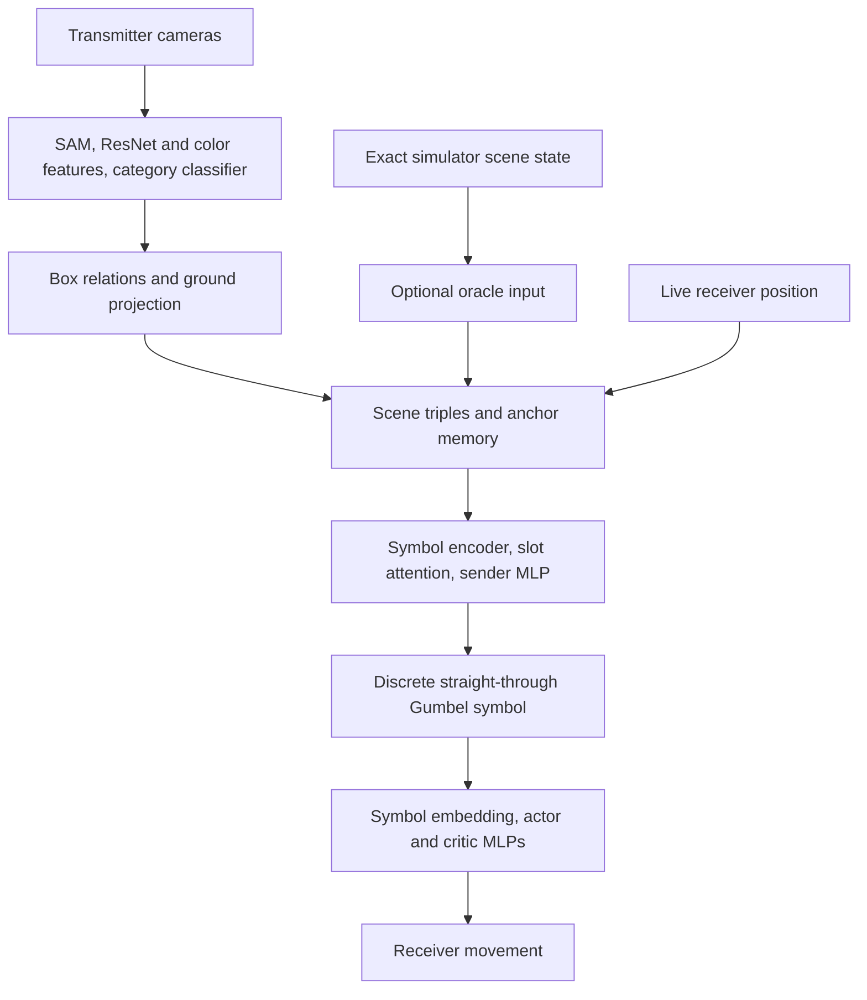

# Gumbel communication architecture

The sole policy is a categorical Gumbel transmitter coupled to a memoryless
receiver. Visual perception and exact simulator input implement the same scene
triple interface. The oracle is an optional fast-testing path.

## Data flow

## Scene input

[SceneVocabulary.py](../representation/SceneVocabulary.py) builds the fixed object vocabulary.
[ScenePerception.py](../perception/ScenePerception.py) converts category predictions to object IDs. SAM proposals are encoded by frozen
ResNet-18 (512 values) plus a masked RGB histogram (64 values). A frozen category
head predicts identity. Box containment/proximity supplies `inside`/`near`
relations; camera ground projection estimates object offsets.

[TransmitterInput.py](../representation/TransmitterInput.py) strips visual receiver detections,
assembles six scene rows, remembers static world anchors within an episode, and
adds one reserved receiver row updated from the simulator each step.
[OracleTransmitterInput.py](../representation/OracleTransmitterInput.py) instead constructs
exact scene rows and anchors. It includes all task objects regardless of visibility
and emits `(lion, inside, cage)` iff the lion is caged. It skips visual inference.

Inputs are transmitter pose `[x/8, y/8, cos(yaw), sin(yaw)]`, triple IDs `[7,3]`,
and egocentric offsets `[7,2,2]`. A row is source/relation/destination; unary rows
and unused tokens use `-1` padding. Static perception runs at reset (and opening
passes in stationary mode), or every 75 steps when colocated. Receiver position
is always refreshed. Shared yaw aligns transmitter geometry and receiver actions.

## Sender and receiver dimensions

At the default four-object scene and 16-symbol vocabulary:

| Component | Shape |
|---|---|
| Object symbols | 4 × 4 |
| Relation symbols | 2 × 4 |
| Triple-position embeddings | 3 × 4 |
| Offset projection | Linear(2, 4), initialized with zero weights and unit bias |
| Encoded rows | 7 × 12 |
| Slot pooling | Seven learned queries, Linear(12, 12) keys and values |
| Sender head | Linear(88, 38), Tanh, Linear(38, 16) |
| Receiver symbol embeddings | 16 × 4 |
| Receiver actor | Linear(4, 4), Tanh, Linear(4, 4) |
| Receiver critic | Linear(4, 4), Tanh, Linear(4, 1) |

Node tokens are `(object_symbol + triple_position) * projected_offset`.
Relation tokens add symbol and position without geometric modulation. Padding
is masked. Slot pooling is one cross-attention operation over triples, yielding
84 features concatenated with the four pose values. The sender has 4,426
parameters; the receiver has 129. Neither policy receives prior messages.
The sender has no private critic. See [SymbolPolicy.py](../communication/SymbolPolicy.py)
and [ReceiverPolicy.py](../communication/ReceiverPolicy.py).

## Channel and optimization

[CommunicationChannel.py](../communication/CommunicationChannel.py) samples independent Gumbel
noise `g`, computes `soft = softmax((logits + g) / temperature)` and a hard one-hot
`argmax(logits + g)`, then returns `hard + soft - stop_gradient(soft)` (with
parentheses preserving an exactly discrete forward value). This is a biased
straight-through surrogate. Positive temperature affects backward smoothing;
hard sampling probabilities are `softmax(logits)`.

[GumbelPPOTrainer.py](../communication/GumbelPPOTrainer.py) stores one scene/noise record per
movement decision and reconstructs the message under current weights during
PPO updates. There are no history prefixes or replay windows. The next decision's
noise is retained across a rollout boundary for bootstrap evaluation and reused
once under updated weights. Episode boundaries clear pending state. Time limits
are finite-task terminals.

Receiver action log-probability supplies the PPO ratio. Gradients from both actor
and critic can reach the sender. Ratios condition on saved noise; this is not an
exact marginal categorical-message policy gradient. Value loss is normalized
by return standard deviation. Defaults: gamma .99, GAE lambda .95, clipping .2,
ten epochs, minibatches 256, Adam learning rate .0003, value coefficient .5,
receiver entropy coefficient .01, gradient clipping .5, and target KL .03.

Sender entropy is computed once per decision from sender categorical logits.
An optional annealed coefficient holds for the first quarter of training,
decays to zero at three quarters, then stays zero. `detach_channel=1` cuts all
receiver-to-sender gradients and requires zero sender entropy bonus.
The training entry point keeps critic-to-sender gradients enabled;
`detach_channel=1` also cuts this path.

Training symbol frequencies count actual sampled discrete messages.
`channel_saturation` describes soft surrogate components below .05 or above .95,
not forward-message discreteness. Evaluation and videos share
[CommunicationEvaluation.py](../evaluation/CommunicationEvaluation.py).

## Checkpoints

Policy state-dictionary names and dimensions are preserved. New configurations
use version 2. The receiver accepts one categorical message per batch item
(`[B,V]`), with no history dimension or context-length setting. Evaluation ignores
context-length metadata in older configurations and also reads version-1 Gumbel
current-message checkpoints. `SceneVocabulary` stores fixed vocabulary/symbols in
`scene_vocabulary_init.pt` and `scene_vocabulary_trained.pt`. Evaluation also
accepts the older `kg_init.pt` filename and tensor format.
Warm starts restore weights only. [Saved results](../results/README.md) document
single-training-seed oracle experiments, not visual generalization.
