# When communication becomes useful: four controlled ALKoG experiments

**Date:** November 13, 2026. **Scope:** finite symbolic decision processes, outside visual perception and MuJoCo.

<a id="simulated-setup"></a>

## Start here: the complete simulated setup

### What actually runs on the computer

An agent here is a learned decision function, not a rendered body with a camera.
The environment stores a small task state, such as a target index or a safe-side
bit. It exposes different parts of that state to two agents. They select public
symbols and task actions, and the environment scores whether the final decision
is correct. This is a deliberately small model of cooperative information use.

There are **two separate layers** in this study:

| Layer | What it contains | Role in the experiments |
|---|---|---|
| Communication decision process | Private facts, permitted observations, discrete messages, choices, memory and costs | The learned policies train and receive their primary scores here |
| Receiver-local navigation checks | Public grid, start cell, obstacles, destinations and a BFS path planner | A separate check shows how a selected destination or passage becomes movement |

**The communication learner does not move through the pictured grid during
training.** It learns the information-dependent choice that would tell a
receiver-local navigator where to go. The grid checks exercise that navigator
separately. There are no rendered lions, cages, food objects, camera images,
collisions integrated by a physics engine, or torque-controlled bodies in these
four experiments. Their target and safety variables stand in for the relevant
facts from the original MuJoCo setting. The earlier spatial PPO study is a
separate experiment and should not be conflated with this one.

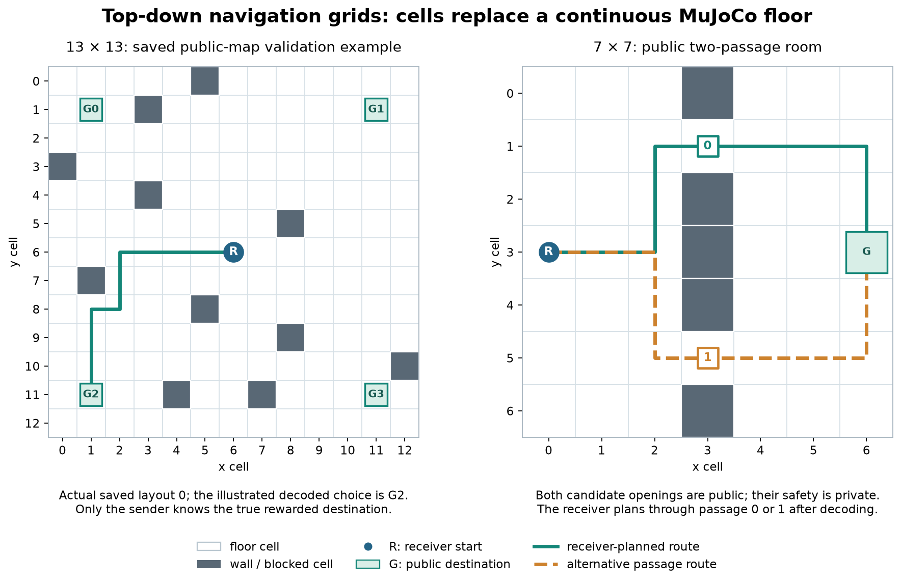

**Figure 1. What the grids look like.** Each square is an abstract position; a move changes x or y by one cell. The left panel uses saved navigation-validation layout 0, including its actual obstacles and its saved path to G2. The right panel uses the exact public wall and passage coordinates of the two-route planner example. The two route lines are alternatives; the receiver executes only the selected route. In MuJoCo terms, white cells correspond to navigable floor, dark cells to obstacles, R to the moving receiver, and G to public candidate destinations. Passage safety is a separate hidden task fact.

**What was simulated during training:** the four-option learners operate on the finite decision processes defined below. These grids are the separate planner geometry used to illustrate and validate autonomous path execution. They are not a spatial grid traversed inside the exact communication-training objective.


### How to read the grid

The left map has 13 columns and 13 rows. The receiver starts at cell (6,6).
Four public destination locations are (1,1), (11,1), (1,11) and (11,11).
Dark cells are public obstacles. The example comes from the first saved
navigation-validation layout, including its actual blocked cells. The displayed
path goes to destination G2. The cells themselves do not reveal which destination
earns reward. That target identity is the sender's private fact.

The right map is one 7-by-7 room. A wall occupies x=3 except at y=1 and y=5.
The receiver starts at (0,3), and the exit is at (6,3). The two candidate passages
are numbered 0 and 1. Both locations are public. Their current safety is private
to the observer/helper. The two colored paths illustrate alternatives; the
receiver follows only the selected one. This is the public geometry of the
planner demonstration, not three physically simulated rooms in the learning loop.

The planner receives a start, a selected public waypoint, public obstacles and
map dimensions. It computes successive neighboring cells, changing x or y by
one each time. It has no access to the true rewarded target or safe-side label.
Navigation ability is supplied by this planner rather than learned. We therefore
isolate the information decision and do not claim to have trained locomotion.

### Who the agents are and what they can observe

The **observer/helper** owns environmental information. The **acting agent** must
complete the task. They are often called sender and receiver, respectively,
because the helper supplies the missing fact. In Options 3 and 4 the acting agent
can send a request first, so those names do not imply a fixed first speaker.

| Option | Helper's private input | Acting agent's permitted input | Acting agent's task choice |
|---|---|---|---|
| 1: Private goal | Which of four destinations is rewarded | Delivered opening word or a known silent slot | Commit to a destination index |
| 2: Changing safety | Current safe side, logical tick, and its predicted communication cache from its own history | Last delivered word in its cache | Choose passage 0 or 1 at a crossing |
| 3: Ask or scout | The true destination | Inspection cost, either the visible destination or an explicit unknown observation, and a reply if requested | Commit, inspect, or ask |
| 4: Complementary knowledge | Eight binary map facts and any received query word | Private entity index Q, its own query, and reply or no-reply observation | Choose the requested entity's safe entrance bit |

The target and safety labels never appear directly in the acting policy's input,
except in conditions explicitly granting observation or using an oracle. The
planner can separately use public coordinates after a waypoint is selected. The
decoder for Option 1, for example, sees a signal rather than the whole grid.
The helper in Option 4 receives a query code, not the acting agent's private Q.
In packet-loss tests the helper does not receive free delivery acknowledgments.

### What a message is

A public word is a discrete ID. Its numeric ID has no preassigned meaning.
The learned encoder and decoder establish a convention through shared reward.
Different seeds can assign different IDs to the same task fact.

Options 1 and 2 allow eight emitted words plus silence. A known silent time
slot can itself be informative. Silence in Option 2 preserves the last delivered
word. The cache is a supplied nine-state memory mechanism: empty or one of eight
words. These runs test use of that mechanism, not discovery of a memory architecture.

Option 3 has one fixed ASK request and one reply chosen from eight learned words.
The entire request/reply exchange costs 0.08. Option 4 has eight possible query
words and two possible answer words. A query word fits into three payload bits.
Labels 1 through 8 are just names for those eight alternatives. A presence bit
distinguishes no request, and the answer uses one further bit. An actual answer
bit with value zero is still a transmitted and charged bit, not silence.

### One episode of Option 1: selecting a private goal

1. The environment selects a destination uniformly from four possibilities.
   The helper observes its index. The acting agent does not.
2. The helper chooses an opening word or silence.
3. The acting agent decodes that signal into a destination index and commits.
4. A correct commitment earns 1. A wrong commitment earns 0 and ends the attempt.
   An emitted packet subtracts 0.05. There is no second trial-and-error guess.
5. In the separate path check, the receiver-local planner can turn the chosen
   index into a path to its public destination coordinates.

**Worked frozen-policy example:** with true target G0, learned seed 0 emits
word 8 and the receiver selects G0. This successful example has
utility 0.95 if a packet is emitted. The complete seed-0 code also uses silence
for one other target, which lowers average transmissions to 0.75 per episode.
These IDs come from the checkpoint, not a hand-written message dictionary.

There is no target-dependent intermediate reward or visual marker that lets a
silent agent discover the answer. Before communication, the four possible
target worlds are indistinguishable to it. This produces the 25% silent bound.

### One episode of Option 2: three safety decisions

One safe-side bit evolves across nine logical ticks, numbered 0 through 8.
It begins equally likely to be 0 or 1 and flips with probability 0.08 between
adjacent ticks. It is one correlated process, not three independent gate draws.
The acting agent must choose correctly at ticks 0, 4 and 8. A wrong choice
terminates the episode. Completing all three choices earns 1. Each attempted
packet before termination subtracts 0.02.

At a tick the helper first observes the current state and chooses whether to
send. Delivery then updates the receiver's cache. If this is a crossing tick,
the receiver chooses a side using that cache. If the episode continues, the
environment applies the possible state flip for the next tick. A logical tick
has no assigned duration in seconds and is not a MuJoCo frame or a grid move.

The following selected history executes the frozen learned seed-0 policy:

| Tick | True safe side | Helper signal | Receiver's decoded choice | Consequence |
|---|---:|---|---:|---|
| 0 | 0 | word 2 | 0 | crossing succeeds |
| 1 | 0 | silence | 0 | no crossing decision |
| 2 | 0 | silence | 0 | no crossing decision |
| 3 | 1 | silence | 0 | no crossing decision |
| 4 | 1 | word 6 | 1 | crossing succeeds |
| 5 | 1 | silence | 1 | no crossing decision |
| 6 | 1 | silence | 1 | no crossing decision |
| 7 | 0 | silence | 1 | no crossing decision |
| 8 | 0 | word 2 | 0 | crossing succeeds |

At a non-crossing tick, an outdated decoded choice does not yet incur failure.
The update must arrive before the next consequential decision. This is why the
agent can remain silent between crossings. Its passage choice could then direct
the local room planner shown above. The primary training score, however, comes
from the three logical decisions, not from executing their physical paths.

### One episode of Option 3: acting, inspecting, or asking

The environment independently selects a target, whether the acting agent can
already observe it, and an inspection cost. The target is uniform over four
possibilities. It is visible in half of episodes. Cost is uniform over 0.02,
0.12 and 0.40, giving 24 equally likely target/visibility/cost combinations.

The first action has six alternatives: commit to one of four targets, SCOUT,
or ASK. SCOUT purchases the correct target identity with certainty and charges
the specified inspection cost. **It is an abstract information-acquisition
action; no journey to a viewpoint is simulated and no travel energy is measured.**
ASK sends the fixed request and obtains a learned categorical reply. It costs
0.02 for the request and 0.06 for the reply. The reply decoder then selects a
target. There is one request/answer exchange, not an unrestricted conversation.

For a hidden target with inspection cost 0.40, a correct asked-for answer earns
utility 1−0.08=0.92; inspection earns 1−0.40=0.60. With cost 0.02, inspection
instead earns 0.98 and asking earns 0.92. When the target is already visible,
the receiver can act directly for utility 1. The desired policy therefore
changes with its own observation and the cost of acquiring information.

### One episode of Option 4: combining a private goal with a private map

The acting agent privately receives Q, one of eight entity indices. The helper
privately receives eight independent binary facts X. Each fact specifies the
safe entrance for one entity. The acting agent needs only XQ, while the helper
initially does not know which entity matters. The task averages all 256 maps
and all eight private indices, giving 2,048 equally likely contexts.

The acting agent can decline to ask or emit a query word. If it asks, the helper
uses that word to select a map slot, encodes its bit into an answer word, and
returns it. The acting agent combines the reply with its own Q to choose a bit.
The helper's lookup, the query code, and the answer interpretation are learned.
The existence of this lookup factorization is supplied by the architecture.

**Worked frozen-policy example:** seed 2 has Q=3 and map
X=[1,0,0,1,0,1,0,1]. Its query is word 4. The helper's learned lookup
selects slot 3, whose fact is 1, and emits answer word 0. The acting
agent decodes entrance 1. Answer word zero can therefore encode a fact
with value one under a learned convention. Word labels and task facts are
different quantities.

A requested exchange charges five bits: one presence flag, three query bits
and one answer bit. At 0.02 per bit, a correct requested answer gives utility
0.90. Declining still charges the protocol's one presence bit. The fully silent
reference disables the protocol entirely and has zero communication cost.
The full-map broadcast reference sends eight bits for perfect accuracy at
utility 0.84. The separately learned one-way compression reference has a fixed
five-bit message and never observes Q.

### What resets, what learns, and what the reported scores mean

An episode resets task facts and any communication cache. Learned weights
persist across episodes. Each optimization seed initializes a new set of
probability tables. There are no pretrained language models or visual models.

The tables are small categorical policies. Their entries are trainable logits,
which softmax turns into probabilities. Training updates the helper and actor
jointly to increase expected success after resource charges. The environment
provides a reward function, not a list of correct public words. An initially
arbitrary convention becomes useful when the receiver's interpretation and the
helper's production align.

**One update is not one sampled episode.** The optimizer sums probabilities of
possible states, symbols and actions and differentiates that expected reward.
The route task propagates surviving probability mass across its nine ticks.
This is exact known-model optimization, not sampled PPO. All logical task states
are available in training, so the results do not establish generalization to
unseen semantic states. Extra warm-up learning supplies a useful reply code
for warm scouting and a learned reference convention for warm dialogue.

Final scoring freezes the tables. The primary score uses each component's
highest-probability choice. A secondary score keeps sampling from its learned
probabilities. Exact population expectations are primary; one million separate
sampled executions check the evaluator. The 128 new map layouts exercise the
planner separately. They do not turn the finite communication study into a
joint spatial reinforcement-learning experiment.

### Why this stage is outside MuJoCo

The immediate question is whether the information structure makes communication
useful and whether the agents can learn when to use it. Separating that question
from visual recognition and movement execution gives us several controls:

- **Information access is explicit.** We can verify that a target or safe-side
  fact reaches only its owner, and derive the best silent success probability.
  A rendered scene can accidentally reveal the answer through a marker, object
  placement, or sensor field.
- **Failures have fewer possible causes.** If a receiver makes a wrong choice,
  we can distinguish a poor protocol from a missing fact. There is no additional
  uncertainty about image recognition, localization, locomotion, or collisions.
- **Counterfactuals are exact.** We can block, change, delay in an extended model,
  or lose packets and inspect the resulting decision process. The current
  implemented interventions are specified later; delay is not tested here.
- **Optimization and baselines are auditable.** The finite state spaces let us
  enumerate alternatives and calculate bounds. This would be much harder for
  continuous physical states with raw image observations.
- **Repeated runs are inexpensive.** We can check several starts and inspect
  complete code tables without rendering scenes or loading perception assets.
  This is a practicality argument, not a measured speed comparison with MuJoCo.

MuJoCo itself was not the reason the previous task lacked a communication
advantage. A cheap conservative route removed much of the need for information.
The same task-design problem can exist with or without physics. Conversely,
these redesigned information gaps could be recreated inside MuJoCo.

The simplification also removes difficulties we eventually need to test:
perception errors, observation latency, continuous geometry, uncertain motion,
physical feasibility, and time available to react. Success here supplies a
controlled demonstration under stated assumptions; it does not establish
successful or safe behavior in the original physical scene. Changing both the
task and the learner from the earlier PPO study also prevents attributing the
improvement to a single cause.

### How the result would map back to MuJoCo

1. Keep the redesigned private facts, permitted observations, available choices,
   and resource costs while replacing tables with a neural communication policy
   trained from sampled structured observations.
2. Recreate a task in MuJoCo with oracle structured observations. A receiver-local
   controller executes the selected destination or passage. Test task success
   and movement failures separately.
3. Replace oracle facts with learned perception. The helper must detect actual
   rendered state changes, while the actor retains only its permitted sensors.
4. Add and measure realistic detection errors, channel delay, action delay and
   motion uncertainty. Re-evaluate the protocol and the silent baselines.

Transfer requires more than matching the picture. The task-relevant facts,
observation asymmetry, time of important decisions, alternative ways to obtain
information, and reward/cost definitions must remain comparable. Those are
conditions to test, not an equivalence already established by this study.


## Executive conclusion

Communication helps in the redesigned tasks. The first two demonstrate a large success-rate advantage when the receiver lacks essential information. The third demonstrates an efficiency advantage while preserving the ability to act without communication. The fourth demonstrates a benefit of asking for relevant information rather than broadcasting the entire world, but learned dialogue remains imperfect and depends strongly on a preparatory reference-learning stage.

**Verdict: Options 1–3 pass their pre-specified criteria. Option 4 is a partial success and fails the across-seed criterion:** its mean accuracy is 95%, but one optimization seed has utility 0.795, below full-map broadcast at 0.84. Two of its five warm-start runs achieve perfect accuracy.

| Option | Primary learned result | Relevant alternative | Finding |
|---|---|---|---|
| Private goal | Success 1.0000 ± 0.0000; 0.7500 ± 0.0000 transmissions | Silent success 0.25 | Information closes an otherwise unavoidable gap |
| Changing route safety | Success 1.0000 ± 0.0000; 1.3922 ± 0.0275 transmissions | Silent success 0.2805; continuous uses 9 | Remembered information plus occasional updates works |
| Scouting | Utility 0.9700 ± 0.0000; 0.6667 ± 0.0000 packets | Best silent utility 0.91; always ask 0.92 | Learn when to ask, inspect, or act independently |
| Complementary knowledge | Success 0.9500 ± 0.0523; utility 0.8580 ± 0.0439 | Silent accuracy 0.50; full-map broadcast utility 0.84 | Interactive requests help, with residual learning failures |

The numbers are means ± sample standard deviations across five optimization seeds. Success probabilities are exact expectations over the finite task distribution (up to floating-point rounding near 10⁻⁶), not estimates from a small test sample. “100%” therefore means perfect logical performance for that specified finite model and deterministic deployment; it is not a claim of physical safety or general real-world competence.

**Important method qualification:** these experiments use small categorical policy tables and exact expected-reward gradients with a known task model. They are mechanism and environment-design tests. They do not demonstrate that a neural PPO system will discover the same protocols from sampled experience. The strongest scouting and dialogue results include explicitly reported warm-up learning.

## 1. Background: what problem are we trying to solve?

There are two cooperative agents. A sender can observe a fact that its partner cannot observe. A receiver must make a decision and, where appropriate, navigate to the chosen destination. A message is a small discrete public symbol. Its meaning is learned from whether interpreting it improves the shared task outcome; learned symbols are not assigned English meanings.

The desired behavior is an initial exchange when needed, independent action using remembered information, and a later update when that information becomes stale. Communication is useful only if its benefit exceeds its resource cost.

An earlier oracle-grid study allowed the receiver to take a cheap conservative route around uncertain hazards. Its strongest silent-at-evaluation policy reached every goal, so communication did not improve overall return there. That outcome motivated these four changes to the information structure. The present experiments use different tasks and a different learner, so they are not a controlled optimizer-only comparison with the earlier PPO study.

## 2. Common definitions and experimental design

- **Episode:** one complete task attempt. Success receives reward 1; an incorrect terminal decision receives 0. In the route task, all three crossings must be correct.
- **Policy:** a conditional probability distribution over available actions or symbols. A table stores trainable logits; softmax turns them into probabilities.
- **Transmission/packet:** one emitted categorical word. Silence can be observed in a known time slot in Options 1 and 2 and may itself acquire meaning.
- **Utility:** task success minus explicitly defined communication or scouting costs. All costs are expressed in fractions of the unit success reward.
- **Oracle:** a reference that directly supplies missing information. It is deliberately privileged and is not a learned communication result.
- **Fixed informative protocol:** a prescribed code or timing rule used to establish achievability. Such controls are identified separately from learned policies.

For logits l₁,…,lₙ, an action probability is

```text
π(a=i | observation) = exp(lᵢ) / Σⱼ exp(lⱼ).
```

The shared optimization objective is

```text
J = E[ I(success) − communication cost − scouting cost ].
```

I(success) equals 1 on success and 0 otherwise. No positive reward is assigned merely for speaking. The expectation sums private states, messages, and receiver actions. In the route experiment it also sums all status-change histories through a dynamic program. This uses the known reward function for alternatives that were not physically sampled and must not be described as black-box sample efficiency.

With θ denoting the active policy parameters and H the mean categorical entropy, the minimized loss is L(θ)=−J(θ)−βH(θ). Autograd differentiates the finite probability sums; there is no sampled policy-gradient estimator, critic, or PPO objective here. Adam updates θ from these exact gradients. The active tables have 72 parameters for private goals, 1,476 for route safety, 154 for scouting, and 188 for structured dialogue. The one-way broadcast encoder/decoder has 8,704 active parameters. The dialogue/broadcast container also stores unused alternative heads. These are not parameter-count matched architecture comparisons.

Utilities should be compared within a task, not ranked across tasks with different cost definitions. All learned methods receive 1,500 Adam updates at learning rate 0.04, with gradient norm clipped at 5. An entropy bonus of at most 0.02 anneals linearly to zero over the first 600 updates. Entropy initially encourages exploration among words. The final checkpoint is used, without selecting an earlier checkpoint on results. Development seed 97 was separate from final optimization seeds 0–4.

There are 130 evaluated seed–method conditions: 80 optimized policies and 50 prescribed/reference conditions. Repeated reference conditions are not independent learning runs. All seeds are reported, including failures. Tiny exact tables ran on CPU in the existing Windows PyTorch environment; the GPU was available but was not needed for this study.

**Information access:** training code can use true hidden states to calculate rewards. A deployed receiver can use only its designated observations and messages. The sender does not read the receiver’s private neural state. In Option 2 the cached communication index is reconstructible from the shared protocol/history.

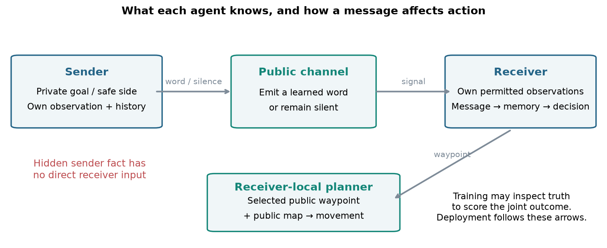

**Figure 2. Information boundaries.** Private facts reach the receiver through the public channel. The receiver selects a waypoint and computes its own movements; a message does not supply a movement stream.

### Navigation and what is held constant

These are finite decision processes coupled to a receiver-local breadth-first search planner. The planner accepts only a start, a selected public waypoint, public obstacles, and map dimensions. It has no argument for the true hidden target or hazard label. The receiver selects its waypoint after interpreting communication and computes its own movement sequence.

Navigation is deliberately solved algorithmically rather than learned jointly. This removes motor learning as a confound. Communication ticks in Option 2 are logical observation opportunities, not MuJoCo physics frames. Costs of scouting in Option 3 are abstract known resource costs, not measured robot energy.

An independent planner check exercised four destinations on 128 newly generated public obstacle layouts. Every produced path was checked for reachability, unit-step movement, and obstacle avoidance. This checks the interface and path executor; it is not an independently trained physical navigation benchmark.

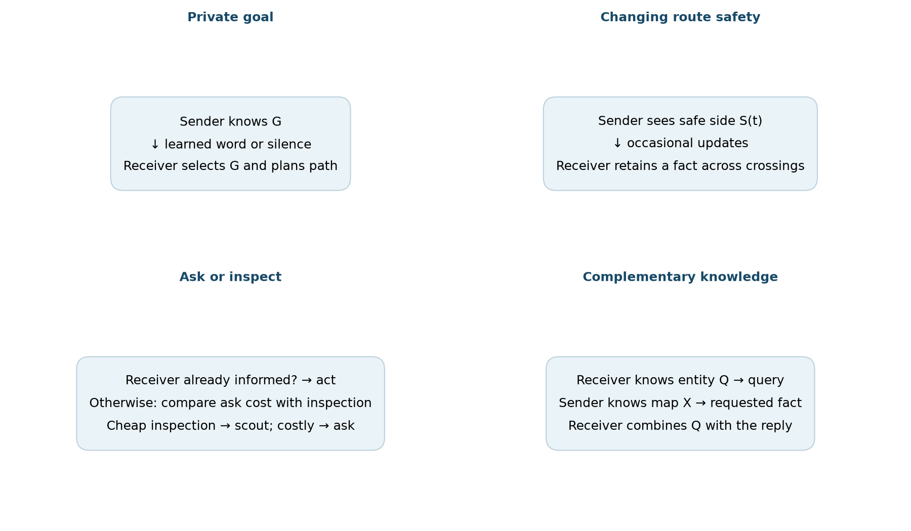

**Figure 3. The four task structures.** These are conceptual diagrams, not simulator screenshots.

## 3. Option 1: privately specified destination

Four candidate destinations are public and reachable. One target G is selected uniformly from {0,1,2,3}. Only the sender sees G. The receiver knows candidate locations and its own pose, but receives no target marker. One destination is selected and committed; a wrong commitment terminates the episode. Exhaustive search and target-dependent intermediate rewards are unavailable.

The sender chooses silence or one of eight words at the opening exchange. The receiver maps the observed signal to a destination index, then plans its own route. Sender and decoder tables start random. A packet costs 0.05.

Writing S(z|g) for the sender and D(g|z) for the decoder, the objective is

```text
J = (1/4) Σg Σz S(z|g) D(g|z) − (0.05/4) Σg P(z ≠ silence | g).
```

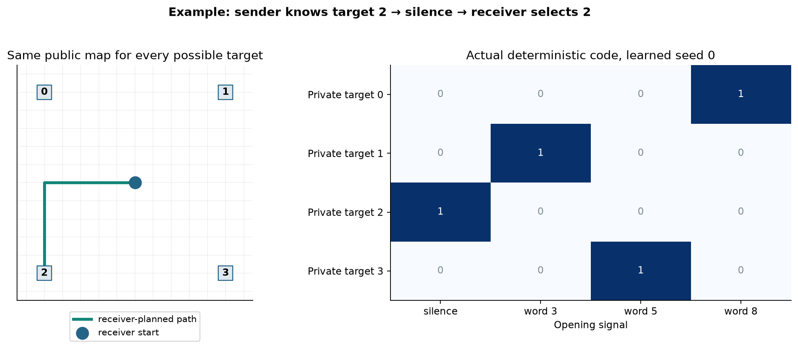

**Figure 4. A goal message and its interpretation.** The left panel is a public-map illustration with a receiver-local path. The right panel shows the actual seed-0 deterministic code: each row is one possible private target; 1 marks its selected signal. The map is unchanged across targets, and silence identifies one target under this learned convention.

### Why silence alone cannot solve it

Let O be all information available to a silent receiver. G is independent of O and uniform. For any possibly randomized receiver policy,

```text
P(correct without communication)
  = Σₒ P(O=o) Σg P(G=g | O=o) π(g | o)
  = Σₒ P(O=o) (1/4) Σg π(g | o)
  = 1/4.
```

This is an information bound, not a weak-baseline learning failure. A receiver given the target through an informative code can select correctly every time.

### Why 0.75 transmissions is legitimate, and what it does not mean

A synchronized silent slot can represent one destination; three emitted words can represent the other three. The expected packet count is therefore 3/4, and perfect-success utility is 1 − 0.05×0.75 = 0.9625. The learned optional protocols found this solution. Silence is an informative event here: 0.75 packets must not be interpreted as only 0.75 bits of information. The four equally likely outcomes still distinguish two bits of target identity. If presence detection or timing has a physical cost, that cost would have to be added.

## 4. Option 2: changing route safety

The receiver must pass three successive bottlenecks, each with two candidate passages. Exactly one passage is safe. Only the sender observes the currently safe passage Sₜ ∈ {0,1}. At each of nine logical communication ticks, the sender may remain silent or emit a word. Crossing decisions occur at ticks 0, 4 and 8. Between adjacent ticks, the safe side flips independently with probability ρ=0.08. A wrong crossing ends the episode. Waiting indefinitely or bypassing the bottlenecks does not complete the task.

The receiver has a persistent cache of the last delivered word and maps that cache to a passage choice. No decoded word supplies individual movement actions. The planner constructs a path through the chosen gate. A packet costs 0.02. The memoryless comparison resets its cache on a silent tick.

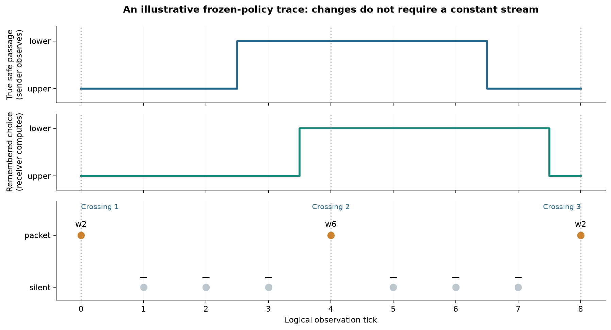

**Figure 5. Remembering between updates.** This selected status history is executed by the frozen learned seed-0 policy. Dotted lines mark the three crossing decisions. A dash is an actual silent slot; word IDs label transmitted packets. The receiver may retain an outdated choice between crossings, provided it is corrected before a consequential decision. This is an explanatory trace, not an additional aggregate experiment.

### Optimal silent success rate

Over Δ independent flip opportunities, the probability that the safe side is unchanged is the probability of an even number of flips:

```text
q(Δ) = [1 + (1−2ρ)^Δ] / 2.
q(4) = [1 + 0.84^4] / 2 = 0.748936.
```

The first silent choice succeeds with probability 1/2. Conditional on surviving a crossing, its safe side is known through that survival. Because q(4)>1/2, repeating the same side at the next crossing is the best silent choice. Thus

```text
P(silent success) = (1/2) q(4)^2 = 0.280452326.
P(success with opening information only) = q(4)^2 = 0.560904653.
```

An informative opening message cannot protect against later unpredictable changes. A prescribed event rule can instead send only when the current safe side differs from the remembered side at a crossing. With a default side encoded by initial silence, its expected packet count is

```text
E[packets, prescribed event rule] = 1/2 + 2[1−q(4)]
                                          = 1.002128.
```

This rule is a reference, not a learned gate. A simpler informative fixed schedule at the three crossing decisions would need three packets; continuous communication over all observation ticks needs nine.

### Exact temporal credit assignment

Let pₜ(s,h) be probability mass still alive at tick t, with safe side s and cached word h. The initial cache is empty. Let πₛ(z|s,h,t) be sender probabilities and D(a|h′) receiver passage probabilities. A delivered word replaces the cache; silence retains it. Each tick propagates mass through the message transition. At a crossing it keeps only the fraction D(s|h′), then applies the status-flip transition before the next tick:

```text
Initial: p₀(s, empty) = 1/2.
Message propagation: p′(s,h′) = Σh,z pₜ(s,h) πₛ(z|s,h,t) P(h′|h,z).
Crossing only:        p′(s,h′) ← p′(s,h′) D(s|h′).
Next status:         pₜ₊₁(s,h′) = (1−ρ)p′(s,h′) + ρp′(1−s,h′).
J = final surviving probability − 0.02 E[attempted packets before termination].
```

This recurrence allows an early message to receive credit for a later crossing. It sums all state/message paths without exposing the true side to the receiver. It does assume knowledge of the transition model during training.

## 5. Option 3: asking versus independent scouting

There are again four possible targets. In half of episodes, the receiver already observes the target. In the other half it does not. Independently, an inspection point has a public cost d chosen uniformly from {0.02, 0.12, 0.40}. The receiver can commit immediately, scout and then learn the target, or ask its partner. The sender always knows the target.

An ASK sends a fixed request costing 0.02 and obtains one categorical reply costing 0.06. Every reply word, including word zero, costs the same. The total ask cost is c=0.08; there is no free target-specific missing reply. The receiver learns which reply identifies which destination. A visible target can be reached without asking or scouting.

Let A(g|o), A(scout|o), and A(ask|o) be first-action probabilities for receiver observation o. Let Cg=Σz S(z|g)D(g|z) be reply-code correctness for target g. Averaging the 24 combinations of visibility, cost and target gives

```text
J = E[ A(G|o) + A(scout|o)(1−d) + A(ask|o)(CG−0.08) ].
```

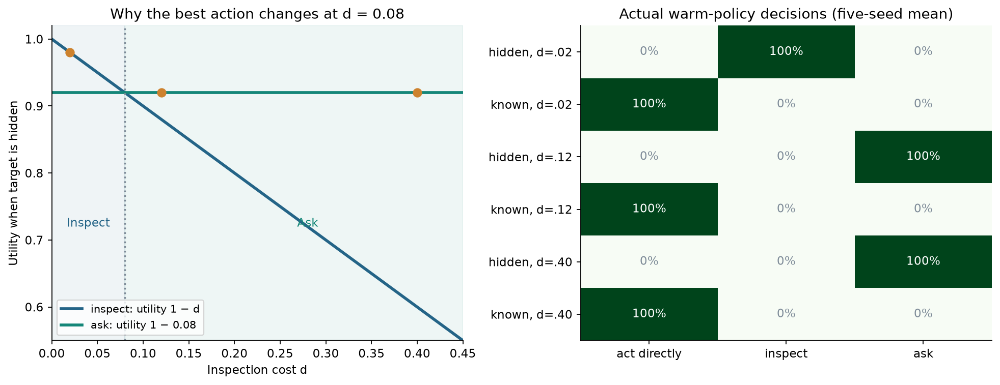

**Figure 6. Communication as an optional tool.** With a reliable reply, asking wins when inspection costs more than 0.08; inspection wins when it costs less. The heatmap displays measured five-seed warm-policy action frequencies. A receiver that already knows the target acts directly.

### The optimal decision rule

When the target is unknown, an immediate guess has expected utility 1/4. Perfect scouting has utility 1−d, and an informative exchange has utility 1−c. All scouting costs here are below 3/4, so scouting beats guessing. With a reliable code, asking should be chosen exactly when c<d:

```text
If target already known: act directly; cost = 0.
If target hidden: choose min(d, c) to obtain it.
Best silent utility = 1 − (1/2)(0.02+0.12+0.40)/3 = 0.91.
Optimal optional utility = 1 − (1/2)(0.02+0.08+0.08)/3 = 0.97.
Always ask utility = 1 − 0.08 = 0.92.
P(ask optimally) = (1/2)(2/3) = 1/3.
E[packets] = 2 P(ask) = 2/3.
```

This task makes communication a genuine tool: silence can be optimal, scouting can be optimal, and asking can be optimal in different observable contexts. Success alone is uninformative because a silent scout can also succeed every time; the meaningful comparison is utility and conditional action choice.

Two learned variants start with random request decisions. The cold variant also starts with a random reply code. The warm variant first trains that code for 600 extra updates by maximizing exact destination-selection reward. Word meanings remain learned. This isolates whether poor initial communication prevents the receiver from discovering that asking is worthwhile. It is extra training, not a fair claim of equal total compute.

## 6. Option 4: private goal plus private hazard map

The receiver privately knows an entity index Q chosen uniformly from eight possibilities. The sender privately sees a map X=(X₀,…,X₇) of eight independent fair binary facts, such as which entrance is safe for each entity. The receiver must choose XQ. Neither agent initially has all information needed.

A learned dialogue starts with an optional request. A one-bit presence flag is charged in every episode. If a request is made, its word identifies one of eight query codes (three bits), and the helper returns a learned binary word (one bit). Total cost is therefore five bits when asking and one flag bit when declining. Each bit costs 0.02. The no-communication reference disables the entire protocol and costs zero bits. Requests and replies count as two packets but their total bit cost, rather than packet count alone, is used for fair comparison.

The receiver learns a query-word distribution from its private index. The helper learns a categorical lookup over the map’s entity slots for each query word, then a binary encoding of the selected fact. The receiver interprets that word using its own query context. This is a structured lookup inductive bias; it is not evidence that arbitrary relational syntax emerged. At deterministic deployment, each categorical component selects its argmax.

Let Q(z|q) be the request policy, L(i|z) the helper’s entity lookup, E(b|x) its binary word encoder, and D(x|q,b) the receiver’s answer policy. z=0 denotes no request; ∅ is the no-reply observation. The expectation below averages all 256 maps and eight private indices:

```text
J = E[X,q] { Q(0|q) D(Xq|q,∅)
              + Σz≠0 Q(z|q) Σi L(i|z) Σb E(b|Xi) D(Xq|q,b) }
    − 0.02 [1 + 4 P(request)].
```

A cold dialogue learns all components jointly. A warm dialogue first receives 1,000 additional reference-game updates: query words and helper lookups learn to identify the same entity slot. These words are randomly initialized and receive no prescribed English meaning. Hazard reply learning then proceeds through the main task reward.

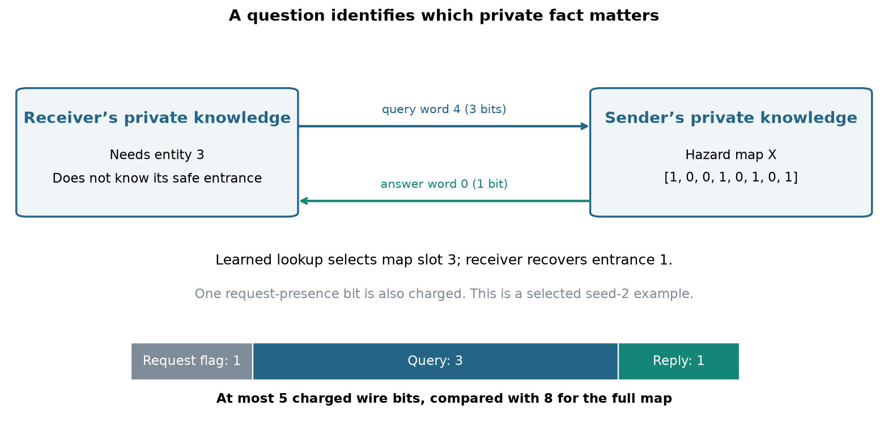

**Figure 7. Asking for the relevant fact.** A selected seed-2 dialogue illustrates the learned query and reply codes. The helper needs the query to choose the relevant map slot. The presence flag is included in the five-bit budget. This successful example does not replace the five-seed reliability results.

### Why asking can be cheaper than broadcasting

Without any map information, the receiver is correct with probability 1/2. Broadcasting all eight map bits permits perfect accuracy but utility 1−0.02×8 =0.84. A correct request/answer protocol needs at most five bits and can achieve utility 1−0.02×5=0.90. The helper is told which fact matters, so it can avoid describing unrelated facts.

We also trained a one-way encoder with exactly five binary wire bits: 32 possible codewords. It sees the whole map but never Q; its decoder sees both the codeword and Q. It is a learned map-compression baseline.

### A bound for every one-way five-bit protocol

Let M be a one-way five-bit message, so H(M)≤5 bits. Because the eight map bits are independent and uniform, H(X)=8. Let Dᵢ be the probability of incorrectly reconstructing bit i from M, and D the average of the eight Dᵢ. The receiver’s average query error equals D because Q is uniform and independent. For binary errors, the entropy bound and concavity of binary entropy imply

```text
h₂(d) = −d log₂(d) − (1−d) log₂(1−d).
H(X|M) = H(X) − I(X;M) ≥ 8−5 = 3.
H(X|M) ≤ Σᵢ H(Xᵢ|M) ≤ Σᵢ h₂(Dᵢ) ≤ 8 h₂(D).
Therefore h₂(D) ≥ 3/8.
```

Numerically, D≥0.072449792, so **one-way five-bit accuracy is at most 92.7550%**, even with an optimal encoder. This is a valid upper bound rather than a claim that some finite code achieves it. The learned broadcast baseline can perform below the bound because optimization and finite-block coding need not attain it.

The dialogue does not violate the bound: its reply is conditional on the receiver’s query. The same one-way message must support every possible index; a queried reply only has to support the requested index. A sender-dependent timing side channel is not granted to the fixed five-bit broadcast. The dialogue’s request-presence bit is explicitly charged.

The entropy argument is the binary-source/Hamming-distortion converse, also discussed in the [Martinian–Wornell primary paper](https://sia.mit.edu/dev_site/wp-content/uploads/2015/04/2004-martinian-wornell-allerton.pdf). The finite eight-bit derivation above gives the assumptions used here directly.

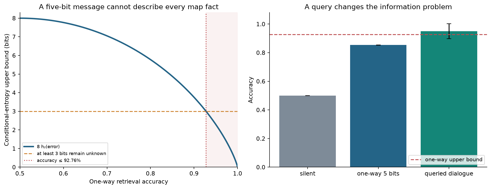

**Figure 8. Reading the information bound.** The left-hand curve must remain above three bits of residual uncertainty, which limits one-way five-bit accuracy to about 92.76%. The right panel compares existing measurements with that bound. Queried dialogue changes the sender’s information, so the one-way bound does not apply to it. Error bars show variation across seeds.

## 7. Full results

Primary deployment chooses the highest-probability action at each categorical component. Sampled deployment results are also included in the CSV. Mean ± sample standard deviation describes variation across optimization seeds, not uncertainty from missing test states. Reference policies repeated across seeds usually have zero spread because they are prescribed.

### 1. Private goal

| Method | Success | Utility | Packets | Bits (if defined) |
|---|---:|---:|---:|---:|
| learned | 1.0000 ± 0.0000 | 0.9625 ± 0.0000 | 0.7500 ± 0.0000 | — |
| continuous | 1.0000 ± 0.0000 | 0.9500 ± 0.0000 | 1.0000 ± 0.0000 | — |
| silent | 0.2500 ± 0.0000 | 0.2500 ± 0.0000 | 0.0000 ± 0.0000 | — |
| fixed | 1.0000 ± 0.0000 | 0.9500 ± 0.0000 | 1.0000 ± 0.0000 | — |
| oracle | 1.0000 ± 0.0000 | 1.0000 ± 0.0000 | 0.0000 ± 0.0000 | — |

### 2. Changing route safety

| Method | Success | Utility | Packets | Bits (if defined) |
|---|---:|---:|---:|---:|
| learned | 1.0000 ± 0.0000 | 0.9722 ± 0.0005 | 1.3922 ± 0.0275 | — |
| memoryless | 1.0000 ± 0.0000 | 0.9580 ± 0.0164 | 2.1000 ± 0.8216 | — |
| continuous | 1.0000 ± 0.0000 | 0.8200 ± 0.0000 | 9.0000 ± 0.0000 | — |
| opening | 0.5609 ± 0.0000 | 0.5409 ± 0.0000 | 1.0000 ± 0.0000 | — |
| silent | 0.2805 ± 0.0000 | 0.2805 ± 0.0000 | 0.0000 ± 0.0000 | — |
| fixed_event | 1.0000 ± 0.0000 | 0.9800 ± 0.0000 | 1.0021 ± 0.0000 | — |
| oracle | 1.0000 ± 0.0000 | 1.0000 ± 0.0000 | 0.0000 ± 0.0000 | — |

### 3. Communication versus scouting

| Method | Success | Utility | Packets | Bits (if defined) |
|---|---:|---:|---:|---:|
| learned_cold | 1.0000 ± 0.0000 | 0.9460 ± 0.0329 | 0.4000 ± 0.3651 | — |
| learned_warm | 1.0000 ± 0.0000 | 0.9700 ± 0.0000 | 0.6667 ± 0.0000 | — |
| always_ask | 1.0000 ± 0.0000 | 0.9200 ± 0.0000 | 2.0000 ± 0.0000 | — |
| silent | 1.0000 ± 0.0000 | 0.9100 ± 0.0000 | 0.0000 ± 0.0000 | — |
| scout_only | 1.0000 ± 0.0000 | 0.9100 ± 0.0000 | 0.0000 ± 0.0000 | — |
| fixed | 1.0000 ± 0.0000 | 0.9700 ± 0.0000 | 0.6667 ± 0.0000 | — |
| oracle | 1.0000 ± 0.0000 | 1.0000 ± 0.0000 | 0.0000 ± 0.0000 | — |

### 4. Complementary knowledge

| Method | Success | Utility | Packets | Bits (if defined) |
|---|---:|---:|---:|---:|
| dialogue_cold | 0.8500 ± 0.0342 | 0.7740 ± 0.0288 | 1.4000 ± 0.1369 | 3.8000 ± 0.2739 |
| dialogue_warm | 0.9500 ± 0.0523 | 0.8580 ± 0.0439 | 1.8000 ± 0.2092 | 4.6000 ± 0.4183 |
| broadcast5 | 0.8531 ± 0.0011 | 0.7531 ± 0.0011 | 1.0000 ± 0.0000 | 5.0000 ± 0.0000 |
| silent | 0.5000 ± 0.0000 | 0.5000 ± 0.0000 | 0.0000 ± 0.0000 | 0.0000 ± 0.0000 |
| fixed_dialogue | 1.0000 ± 0.0000 | 0.9000 ± 0.0000 | 2.0000 ± 0.0000 | 5.0000 ± 0.0000 |
| fixed_broadcast | 1.0000 ± 0.0000 | 0.8400 ± 0.0000 | 1.0000 ± 0.0000 | 8.0000 ± 0.0000 |
| oracle | 1.0000 ± 0.0000 | 1.0000 ± 0.0000 | 0.0000 ± 0.0000 | 0.0000 ± 0.0000 |

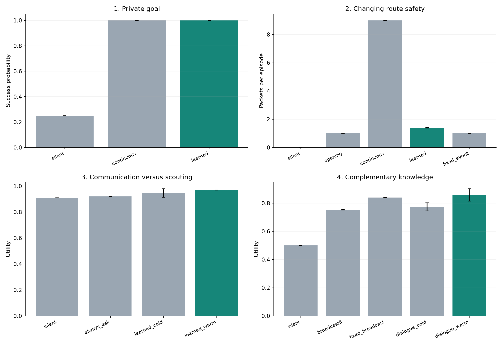

**Figure 9. Existing experimental outcomes.** Compare bars within each panel. The route panel shows packet counts: its silent policy sends nothing but succeeds only about 28% of the time. Error bars show standard deviation across optimization seeds.

## 8. Did each option meet its success criterion?

Criteria were saved in `protocol.json` before the five-seed final study. They are task-specific: the scouting task needs an efficiency improvement, while the private-goal task needs a success improvement.

| Task | Criterion | Verdict |
|---|---|---|
| Private goal | Mean success ≥95%; every seed exceeds 25% | PASS |
| Route safety | Mean success ≥95%; every seed beats silent utility; ≤4.5 packets | PASS |
| Scouting | Warm mean utility ≥0.965; all seeds >0.91; appropriate conditional asking | PASS |
| Complementary | Warm mean success ≥95%; all seed utilities >0.84; mean accuracy exceeds one-way bound | FAIL |

**A high mean is not a reliability guarantee.** The warm dialogue averages 95% accuracy but fails the required per-seed utility comparison. Its outcomes below expose unreliability hidden by an aggregate mean. If zero incorrect hazard decisions were required, the imperfect dialogue seeds would fail that stricter criterion.

## 9. What the interventions establish

Blocked delivery prevents information arriving while retaining the original attempt/request charge. Constant payload replaces every emitted word with one word; a known silent slot remains silent. A permutation systematically changes the word mapping. These are interventions on frozen pairs, not retrained no-communication baselines. A frozen partner may depend on information that an independently trained silent partner would compensate for differently.

| Primary learned pair | Normal success | Blocked | Constant payload | Permuted words |
|---|---:|---:|---:|---:|
| 1. Private goal | 1.0000 ± 0.0000 | 0.2500 ± 0.0000 | 0.4500 ± 0.1118 | 0.4000 ± 0.2236 |
| 2. Changing route safety | 1.0000 ± 0.0000 | 0.2805 ± 0.0000 | 0.3369 ± 0.0515 | 0.2435 ± 0.2256 |
| 3. Communication versus scouting | 1.0000 ± 0.0000 | 0.7500 ± 0.0000 | 0.7500 ± 0.0000 | 0.7167 ± 0.0456 |
| 4. Complementary knowledge | 0.9500 ± 0.0523 | 0.5000 ± 0.0000 | 0.5000 ± 0.0000 | 0.5000 ± 0.0000 |

For route safety, suppressing all updates after the opening exchange tests whether later information matters; resetting memory tests whether the protocol relies on retention; 25% independent packet loss tests robustness. These effects are integrated exactly using separate sender-predicted and receiver-delivered caches. The sender retains its own intended transmission history and receives no free delivery acknowledgments. Under the reliable normal channel the caches coincide; under corruption they may differ.

| Route intervention | Success | Packets attempted | Utility |
|---|---:|---:|---:|
| normal | 1.0000 ± 0.0000 | 1.3922 ± 0.0275 | 0.9722 ± 0.0005 |
| blocked | 0.2805 ± 0.0000 | 1.1096 ± 0.0275 | 0.2583 ± 0.0005 |
| constant | 0.3369 ± 0.0515 | 1.2038 ± 0.1095 | 0.3128 ± 0.0493 |
| permute | 0.2435 ± 0.2256 | 1.1850 ± 0.1467 | 0.2198 ± 0.2227 |
| suppress_updates | 0.5609 ± 0.0000 | 1.3291 ± 0.0275 | 0.5343 ± 0.0005 |
| reset_memory | 0.5126 ± 0.0106 | 1.2840 ± 0.0185 | 0.4869 ± 0.0106 |
| drop25 | 0.7672 ± 0.0010 | 1.3153 ± 0.0272 | 0.7409 ± 0.0014 |

For complementary knowledge, `remove_query` forces the helper to use the same query-word input irrespective of what the receiver requested. The helper therefore loses the information selecting the relevant map fact.

Warm dialogue success with query information removed: **0.5625 ± 0.0000**.

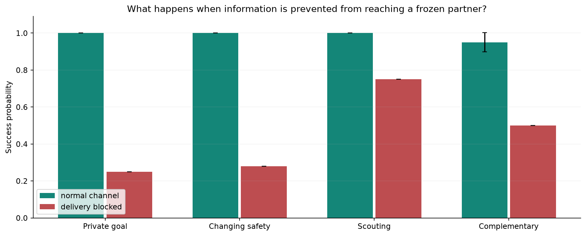

**Figure 10. Causal delivery intervention.** Blocking delivery harms these frozen communicating pairs. This supports a role for the channel but is a different comparison from retraining a silent partner. Error bars show sample standard deviations across the five trained seeds.

## 10. Conditional behavior and optimization failures

### Scouting decisions

| Inspection cost | Target visible? | Warm P(ask) | Warm P(scout) | Cold P(ask) |
|---|---|---:|---:|---:|
| 0.02 | no | 0.0000 ± 0.0000 | 1.0000 ± 0.0000 | 0.0000 ± 0.0000 |
| 0.02 | yes | 0.0000 ± 0.0000 | 0.0000 ± 0.0000 | 0.0000 ± 0.0000 |
| 0.12 | no | 1.0000 ± 0.0000 | 0.0000 ± 0.0000 | 0.6000 ± 0.5477 |
| 0.12 | yes | 0.0000 ± 0.0000 | 0.0000 ± 0.0000 | 0.0000 ± 0.0000 |
| 0.4 | no | 1.0000 ± 0.0000 | 0.0000 ± 0.0000 | 0.6000 ± 0.5477 |
| 0.4 | yes | 0.0000 ± 0.0000 | 0.0000 ± 0.0000 | 0.0000 ± 0.0000 |

Cold scouting sometimes settled on inspection before learning a useful reply code. Inspection supplies perfect task success, so additional channel learning can receive little incentive once asking is rarely chosen. The warm-up addresses this bootstrap problem and is part of the reported method.

### Dialogue reliability

| Seed | Cold accuracy | Warm accuracy | Warm utility | Warm request probability |
|---|---:|---:|---:|---:|
| 0 | 0.8125 | 0.9375 | 0.8475 | 0.8750 |
| 1 | 0.8750 | 0.8750 | 0.7950 | 0.7500 |
| 2 | 0.8750 | 1.0000 | 0.9000 | 1.0000 |
| 3 | 0.8125 | 1.0000 | 0.9000 | 1.0000 |
| 4 | 0.8750 | 0.9375 | 0.8475 | 0.8750 |

Some learned query conventions leave an entity inadequately represented. A query then receives no reliable answer or is not asked, leaving approximately chance performance for that entity. The prescribed dialogue reaches 100%, so this gap is an optimization/protocol-learning limitation, not an information-theoretic impossibility. The structured lookup and referential warm-up materially affect this result.

The learned route protocol also uses more packets than the prescribed event reference. It discovers an effective sparse protocol without establishing minimum communication. A memoryless receiver can still exploit silence as a default-side signal, so its perfect success does not demonstrate persistent memory; its higher packet count is the relevant contrast.

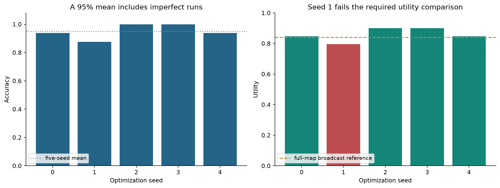

**Figure 11. Why the fourth option is only partially successful.** Average accuracy conceals the low-performing seed. The red utility bar lies below the full-map broadcast reference and causes the pre-specified across-seed criterion to fail.

## 11. Independent execution checks and statistical interpretation

The primary evaluator sums finite probabilities exactly. Independently written sampled execution code ran 50,000 episodes for each primary method and seed (20 policies, one million episodes), using new generator seeds beginning 80000019. It sampled the private variables and, in the route task, executed the nine-step status process. Sampled accuracy, utility and packet counts were checked against the exact evaluator. These are independent draws from the same finite distribution, not unseen semantic states.

For a sampled success fraction p̂ from n independent episodes, the approximate sampling standard error is sqrt[p̂(1−p̂)/n]. This sampling error is distinct from the standard deviation across five trained seeds. Since primary scores are exact finite-population expectations, no test-episode confidence interval is attached to them. Five seeds do not establish behavior of every future optimization run.

Tests independently enumerate all 512 status histories for a deterministic route policy and compare them with the dynamic program. Other tests check silent bounds, fixed informative controls, scouting observations, dialogue bit charges, gradients, and receiver-local path interfaces. The full existing standalone Gumbel experiment-pipeline suite is also run; its saved log supplies the final test count.

## 12. Limitations and connection back to ALKoG

1. **Known-model training:** exact reward gradients use more information than ordinary sampled PPO. These experiments establish helpful task structure and learnable finite protocols, not end-to-end neural RL performance.
2. **Finite lookup policies:** all logical states are available in training. There is no claim of generalization to unseen objects, layouts as policy features, relations, or languages. New planner layouts exercise navigation only; communication chooses public entity slots.
3. **Architectural support:** persistent cache memory and a query-conditioned entity lookup are supplied. Their existence is not an emergent discovery.
4. **Cost assumptions:** numeric packet, bit and scouting costs are experiment parameters. Changing them can change the optimal choice. Success without charging these resources is not the same objective as utility.
5. **Timing information:** silence can carry information when observation slots are synchronized. Presence and framing costs need explicit treatment in real channels; Option 4 includes its request flag.
6. **Simplified dynamics:** route changes are observable to the sender before a crossing decision; no surprise change makes the selected crossing unavoidably fail after commitment. Timing and transition-distribution shifts were not evaluated.
7. **No vision or physics:** no cameras, perception noise, MuJoCo stepping, torque control, physical lion behavior, or visual cage inference is trained here.

A direct transfer path is to retain these information boundaries while replacing the finite tables with the repository’s neural encoder/decoder and sampled actor–critic learning. The private-goal task first tests whether a channel can become informative; the route task then tests retained facts and selective updates; scouting tests whether communication is chosen economically. Complementary dialogue should follow after its cold-start reliability improves.

After that, reproduce the task in MuJoCo with oracle observations, keeping navigation local to the receiver. Only then replace oracle facts with perception estimates. The sender must be able to observe actual rendered state changes, and the receiver must not accidentally receive target markers or privileged geometry that remove the communication problem.

### Development and implementation checks

A separate 600-update development study used seed 97. In that study cold dialogue reached 81.25% and warm dialogue reached 100%; the five-seed final results show why a single favorable development run is insufficient. The 1,500-update final budget and criteria were fixed before seeds 0–4 were run.

Implementation checks corrected a prescribed scouting control so that its request decision was genuinely the stated optimal reference, and supplied uniform default responses for unused words in fixed codes. A full reproducibility rerun retained identical learned weights. Channel-corruption evaluation was separately checked with two caches so that the sender did not receive an implicit acknowledgment. No learned primary-policy parameters were tuned to improve the final reported scores.

## 13. Reproducibility and artifact guide

**Final regression result: 143 tests passed**, including ten new tests for these communication options.

- `manifest.json`: exact software versions, seeds, costs, training budget and source hashes. `protocol.json`: pre-specified criteria.
- `all-evaluations.csv`: applicable normal/intervention results for both deterministic and sampled policy deployment.
- `verdicts.json`: criterion outcomes and the five primary rows per task.
- The artifact ZIP contains all final weights, optimizer/RNG states, learning curves, exact evaluations, independent execution checks, navigation examples, source snapshots, tests, and the development study.
- The prior oracle-grid report remains separate. No old results were overwritten and no remote branch was pushed.

Related research: [Foerster et al., Learning to Communicate with Deep Multi-Agent Reinforcement Learning](https://arxiv.org/abs/1605.06676) studies learned discrete communication under partial observability. The current implementation is a smaller exact-gradient diagnostic, not a reproduction of RIAL or DIAL.

## Appendix: primary results for every seed

| Task | Seed | Success | Utility | Packets |
|---|---:|---:|---:|---:|
| private_goal | 0 | 1.000000 | 0.962500 | 0.750000 |
| private_goal | 1 | 1.000000 | 0.962500 | 0.750000 |
| private_goal | 2 | 1.000000 | 0.962500 | 0.750000 |
| private_goal | 3 | 1.000000 | 0.962500 | 0.750000 |
| private_goal | 4 | 1.000000 | 0.962500 | 0.750000 |
| route_safety | 0 | 1.000000 | 0.972305 | 1.384742 |
| route_safety | 1 | 1.000000 | 0.971668 | 1.416596 |
| route_safety | 2 | 1.000000 | 0.971520 | 1.424015 |
| route_safety | 3 | 1.000000 | 0.972468 | 1.376596 |
| route_safety | 4 | 1.000000 | 0.972823 | 1.358841 |
| scouting | 0 | 1.000000 | 0.970000 | 0.666667 |
| scouting | 1 | 1.000000 | 0.970000 | 0.666667 |
| scouting | 2 | 1.000000 | 0.970000 | 0.666667 |
| scouting | 3 | 1.000000 | 0.970000 | 0.666667 |
| scouting | 4 | 1.000000 | 0.970000 | 0.666667 |
| complementary | 0 | 0.937500 | 0.847500 | 1.750000 |
| complementary | 1 | 0.875000 | 0.795000 | 1.500000 |
| complementary | 2 | 1.000000 | 0.900000 | 2.000000 |
| complementary | 3 | 1.000000 | 0.900000 | 2.000000 |
| complementary | 4 | 0.937500 | 0.847500 | 1.750000 |
