# Learning to communicate about food and danger

A careful walkthrough of the earlier experiments, followed by a new neural PPO study of useful communication and compositional messages. ALKoG research notes. November 14, 2026. All results below come from retained runs; the new study includes every final seed, including failures.

## What the new study established

The agents can use learned discrete messages to obtain food. With a structured four-word protocol, mean successful retrieval on unseen meaning combinations was 98.3% in the context split and 96.7% in the food-pair split, across five training seeds each. The corresponding independently trained silent controls achieved 25.0% and 11.1%. These are neural policies trained with sampled PPO, not the earlier exact probability-table optimizer.

The evidence for grammar is more limited. A reference model with supplied attribute-to-position roles learned word meanings that support recombination; it passed our complete compositional criterion in the context split. The unrestricted recurrent sequence model communicated usefully on familiar meanings but failed strict compositional tests and generalized poorly to new food pairs. A separate optional-tool policy also learned economically wasteful requests. This report therefore distinguishes effective communication, structured generalization, and selective communication timing throughout.

There is no MuJoCo physics, camera perception or learned low-level movement in the new experiment. The observer receives structured facts, the collector chooses a destination and a passage, and a supplied breadth-first-search planner executes the path. This isolates the communication problem. It is a useful scientific intermediate result, with a clear remaining gap to embodied language.

## How to read this document

Sections 1-4 rebuild the earlier setup slowly: what the agents saw, how an episode worked, why the negative result occurred, what the four later table experiments tested, and what facts and policies mean. Sections 5-12 describe the new code, neural learning, held-out tests, complete results and limitations. The appendices retain individual seeds, development attempts, formulas, code locations and reproduction commands. Figures depict actual saved maps, paths and outcomes, rather than illustrative performance numbers.

| Question | Where to look |
| --- | --- |
| What is a grid, episode, observation or policy? | Sections 1 and 2 |
| Were the first agents trained with PPO? | Section 2 |
| What were the four split-information tasks? | Section 3 |
| What are facts, tables and productive grammar? | Section 4 |
| What exactly did we implement now? | Sections 5-7 |
| Did it work, and under which assumptions? | Sections 8-11 |
| How can I reproduce or extend it? | Section 12 and appendices |

# 1. First separate the three generations of experiments

The word agent has been used for several different implementations. An agent is a rule for choosing an action from the information it is allowed to observe. That rule may be a neural network or a learned table. It need not be a rendered animal or a body in a physics engine. A grid is a discrete map: moving right increments x by one, and moving down increments y by one. Coordinates alone do not imply simulated physics.

| Generation | World and observations | Learning and movement |
| --- | --- | --- |
| Original troy_dev branch | MuJoCo scene; visual or oracle scene representation; a sender and receiver | Neural PPO, Gumbel-style symbolic channel, frequent messages and receiver movement |
| First optional-communication study | 11 x 7 kinematic grid; one goal, one stationary lion; hidden risk can change | Neural PPO; receiver learns four cardinal movements, with movement warm-up |
| Four split-information tasks | Finite private variables, message choices, action choices and costs | Learned probability tables optimized by exact expected reward; planner checked separately |
| New study in this document | 11 x 10 food-and-hazard grid, four private attributes and public candidates | Neural PPO for messages and destination/passage choices; BFS movement supplied |

These distinctions answer the earlier question about whether we trained an RL model. The first spatial optional-communication study did use neural PPO. The four intermediate tasks used exact differentiable expected-return optimization over finite policies. The new study again uses sampled neural PPO, but at a destination-and-route decision level. PPO is an optimization method; neural versus tabular is a separate representation choice.

In the original troy_dev arrangement, a sender mapped its scene representation into a vocabulary of 16 symbols through a Gumbel-style communication mechanism. A receiver used its observation and message to choose one of four movements. A memoryless receiver receiving a new word at every step can learn a guidance protocol, such as word 7 meaning move right in the present context. Good performance there does not by itself show that a message conveys a persistent environmental fact.

The motivation for changing this was to let a receiver remember information and navigate autonomously. An opening message could identify a target; another message could announce that a lion is loose. Navigation and communication should have separate jobs. However, making messages optional only helps if the environment contains information the receiver cannot cheaply work around.

# 2. The first optional-communication grid, from scratch

## 2.1 How the 11 x 7 world was constructed

The receiver began at x = 0 in a sampled row y. The reward was at (10,y). The lion was stationary at x = 5: in half the episodes it shared the start row, and otherwise its row was (y + 3) modulo 7. There were no internal walls, cage bodies, chasing dynamics or physics. A caged lion was a harmless cell. A free lion caused a penalty if the receiver entered that cell. Going around it was possible.

Initial risk was a fair binary draw. In half the episodes, its state flipped once, at a sampled decision time from 2 through 7. Otherwise the state stayed fixed. The sender was an observation-and-message policy outside the grid; it did not walk to the goal. The receiver was the only moving agent. Episodes stopped on success, hazard contact or the 24-step horizon; vectorized training padded terminated lanes with absorbing steps.

```python
start = (0, y)
goal = (10, y)
lion = (5, y if on_corridor else (y + 3) % 7)
risk = initial_risk ^ (has_flip and t >= flip_time)
caught = (new_position == lion) and bool(risk)
```

This is a compact reconstruction of the construction and collision logic in earlier/first-grid.py in the source bundle. The lion state is a bit stored by the simulator, not an observed cage image. The grid in Figure 1 is one actual saved episode, so its row is fixed for that example; other episodes sampled other rows.


Figure 1. Saved first-study episode, scene seed 1900001, lane 1, training seed 0. The lion at (5,1) changes from caged to free at decision 3. The communication policy sends 12 packets and detours near the lion; the cold policy detours immediately and sends none. The figure illustrates a mechanism, not a new aggregate evaluation.

## 2.2 What each policy knew

The receiver saw six normalized public numbers: its position and relative offsets to the goal and lion. Thus it already knew where the goal and lion were. It did not directly observe whether the lion was dangerous. The content encoder was given the current risk bit and produced one of four public word IDs. The separate send gate had ten inputs, adding risk, cached status of the last attempted transmission, message age and normalized time to the public information. This is a deliberately narrow content bottleneck, rather than a sender describing arbitrary scenes.

The receiver used either a scalar safety-belief cache or a small recurrent memory such as a GRU with 16 hidden units. A received symbol updated its belief. Silence retained the prior belief. The movement actor combined the six public numbers with that internal state. The centralized training critic could see additional private state; the deployed movement actor could not. Token ID 0 was a real word here. Silence was represented by a separate gate value of zero, not by choosing word 0.

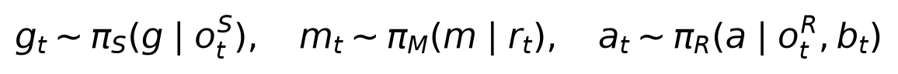

g is the send decision, m the word, r the private risk, b the receiver memory, and a a cardinal movement. The decoder sees a word only when the gate sends it.

```python
send = send_policy(sender_observation).sample()
word = content_policy(risk).sample()
if send:
    belief = decoder(word)
# Otherwise keep the previous belief.
move = movement_policy(public_observation, belief).sample()
```

## 2.3 What was learned and rewarded

Both agents served the same cooperative return. Movement cost encouraged short routes; progress shaping made navigation easier to learn; the food/goal bonus encouraged reaching the goal; a large hazard penalty discouraged contact; a packet charge discouraged excessive communication. The precise first-study reward was:

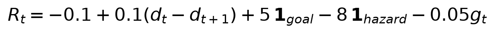

d is Manhattan distance to the goal. This reward belongs to the earlier study; the new study uses a different reward specified in Section 5.

Spatial warm-up taught movement using a BFS teacher. Communication warm-up optimized a prescribed safety-response problem. Joint PPO then sampled gate decisions, words and movements. The recurrent version replayed the same stored sequence and messages when recomputing policy probabilities. The cold arm removed communication warm-up while retaining the movement skill. Thus cold did not mean an entirely uninitialized navigator.

## 2.4 One timestep and one whole episode

At a timestep the simulator exposes the permitted observations; the sender chooses whether to send and which word; a delivered word updates receiver memory; the receiver chooses a movement; the world updates position and checks hazard/goal; all participants receive the shared reward. A status flip changes the risk bit according to the simulator clock. This repeats until a terminal event or horizon.

In the saved example the communication model initially interpreted word 1 as safe and later word 0 as dangerous. It moved right, then went around the lion after the state change and reached the goal in 12 moves. It sent at all 12 decisions and earned return 4.2. The cold model went to a neighbouring row immediately, passed the lion safely and returned to the goal row. It also used 12 moves, sent no words and earned 4.8. The 0.6 difference is exactly the cost of 12 packets in this particular episode.

## 2.5 How we obtained the negative result

The first study retained 42 main runs, 14 methods across three seeds, followed by nine timing/gate follow-ups. The strongest silent cold arm achieved 100% evaluation success with zero transmissions and common-cost return 4.895. A prescribed sparse event control also reached 100% success, but used 1.146 packets per episode and returned 4.889. A learned paired regression gate used 4.749 packets and returned 4.696. These are aggregate results, separate from the illustrated episode.

The negative result was a comparison against a strong learned silent strategy: communication did not beat its overall return in this task. The receiver could see the danger location and take a short universal detour regardless of the hidden state. A silent policy therefore solved the task without needing the private fact. Packet penalties could make communication less valuable than this workaround. This does not establish that communication is generally useless; it identifies a weakness in the experimental information structure. The new task makes the target identity genuinely private.

# 3. The four intermediate split-information tasks

These four studies asked whether communication can help when useful information is divided between agents. Their learners operated on small finite decision processes. The pictured 13 x 13 destination map and 7 x 7 two-passage map in the earlier report were separate navigation checks; those learners did not traverse a spatial grid inside the training objective. They used learned probability tables and known environment probabilities, rather than sampled neural PPO.

## 3.1 Private reward destination

Four destinations were publicly available. Only the sender knew which destination rewarded the receiver. The sender chose one of eight word IDs or silence; the receiver mapped the observed message to a destination. In this particular protocol silence was code 0, unlike the first spatial study where word 0 was a real word. A message could identify a destination without giving movement commands; the receiver-local planner could then navigate there.

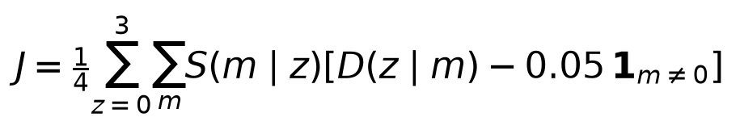

z is the private target, S the sender table and D the receiver table. This is exact expected utility for the finite task.

One learned seed used word 8 for G0, word 3 for G1, silence for G2 and word 5 for G3. Silence therefore became informative under the shared convention. It achieved 100% correctness while sending only 0.75 packets on average, with utility 0.9625. A fully disabled channel achieved 25% correctness. Silence can be a meaningful choice when the parties share the timing of a possible message; it is not automatically equivalent to an unavailable channel.

## 3.2 Two routes with changing safety

A nine-decision sequence represented three route decisions at times 0, 4 and 8, with opportunities to communicate in between. A hidden safe-side bit could flip independently with probability 0.08 per gap. The observer saw it; the receiver had a message cache and selected a route. The sender policy table indexed time, safety, cache and nine communication choices; the receiver table mapped time and cache to two routes. The calculation propagated probability mass exactly through known state transitions.

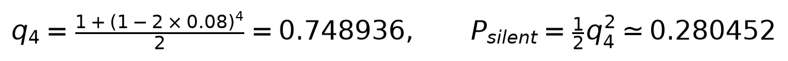

q4 is the probability a fair binary Markov state agrees with its state four gaps earlier. Silent success requires three correct route decisions. This is not the one-flip process from the first grid.

The learned communication policy reached success 1.0 with 1.3922 packets on average, compared with nine opportunities for a continuous sender. An opening-only message achieved about 0.5609 success. The lesson was that state changes can make additional messages useful, but this finite cached-safety task did not require a grammar.

## 3.3 Discover the information yourself or ask

The receiver sometimes already saw the target; otherwise it could inspect, ask the sender or guess one of four destinations. Inspection revealed the target perfectly at a resource cost of 0.02, 0.12 or 0.40. Asking cost 0.08. Inspection here was an abstract acquisition operation, not an agent physically exploring cells. A warm reply curriculum first helped the pair coordinate on target messages.

The useful policy was: act when the target is visible; inspect when hidden information is cheap to obtain; ask when inspection is more expensive than a reliable message. The warm version achieved success 1.0 and utility 0.97, against 0.91 for the silent information-acquisition control. This tested the economics of communication as a tool. It did not show a learned animal walking to a lookout point.

## 3.4 Complementary private information and dialogue

The actor knew which of eight locations mattered, Q. The helper knew a map X containing eight binary safety values, but did not know Q. The actor could ask using one of eight query codes; the helper used a learned lookup convention to identify the requested map bit and returned a binary reply. Both sides therefore had necessary private information. The lookup operation and dialogue structure were supplied.


A binary fact is one true/false variable. Here the eight facts are the eight entries of the safety map. There are 256 possible maps, and 2048 map-query combinations.

The dialogue budget was a presence bit, three query bits and one reply bit: five bits at cost 0.02 each. The full-map reference sent eight bits and had utility 0.84. A perfect short dialogue would have utility 0.90. The warm learned dialogue reached mean accuracy 0.95 and utility 0.858, but one seed returned 0.795, below the full-map reference. This was a qualified average benefit, not reliable success across every seed. Even a no-ask choice paid the presence-bit cost in the enabled protocol; the disabled reference did not.

## 3.5 What a probability table and an exact update are

A policy is a conditional distribution over available actions. A table stores one row of action logits for each possible observation. Applying softmax turns the row into nonnegative probabilities summing to one. For example, a sender may emit word 0 with probability 0.8 for target A, and word 1 with probability 0.7 for target B. A receiver has its own learned response distribution for each word.

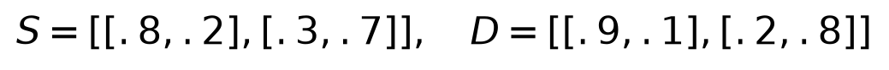

Rows of S index targets; rows of D index received words. Columns of D index chosen targets. Each bracketed inner list is one row.

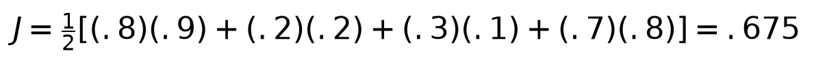

Without communication cost, J is the probability of a correct cooperative decision for the two displayed policies.

```python
sender = sender_logits.softmax(-1)   # state -> message probabilities
receiver = receiver_logits.softmax(-1)  # message -> action probabilities
expected_success = (sender @ receiver).diagonal().mean()
loss = -expected_success
loss.backward()
optimizer.step()
```

This toy code reconstructs the exact optimization idea, not the full dialogue implementation. For the displayed S and D, the gradient of J with respect to sender logits is [[0.056, -0.056], [-0.0735, 0.0735]]. Gradient ascent makes the useful message more likely for each target. The four actual tasks used Adam at learning rate 0.04 for 1500 updates, with task-specific costs, caches and warm-ups. They optimized a differentiable expectation over the known finite world, not PPO rollouts.

When we said these tasks exposed all logical states, we meant their training expectations included every valid assignment of the small hidden variables: all four target states, all safety/cache transitions, or all 2048 map-query pairs. The code could memorize an arbitrary convention for each input combination. Testing a fresh public maze afterward checked navigation execution, not generalization to a previously unseen private meaning.

# 4. Facts, representations and the meaning of grammar

## 4.1 A fact is a task variable, not a word

A fact is a piece of environment information whose value can affect a decision or answer. Examples are the target is an apple, its colour is green, the designated animal is a lion, and it is free. A binary fact has two values, such as caged/free. A categorical attribute may have more than two values, such as four food kinds. Our new task has two four-valued attributes and two binary ones. The term fact does not imply the agents are given English sentences.

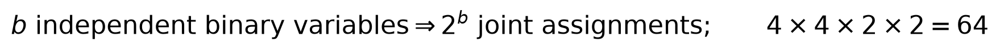

The count 2^b assumes all combinations are valid. Correlations or constraints can reduce the valid set. The new meaning space contains 64 four-attribute assignments, not 64 independent facts.

A flat code could assign one arbitrary token to each of the 64 complete meanings. That may be perfectly useful, but it need not have reusable parts. A compositional code could reuse one symbol for apple, another for green, and an ordering rule telling the listener how those pieces combine. The symbol IDs need not resemble English. What matters is systematic reuse and interpretation on combinations never trained as complete meanings.

## 4.2 Why the old tables did not establish productive grammar

A lookup table can contain a compositional pattern; tables do not mathematically forbid it. The problem was evidential: a single word per complete target and training on all complete input combinations did not require or test productive composition. With no withheld meanings, an arbitrary holistic code was enough. The complementary-information task had a useful query/reply structure, but that structure and the map lookup were explicitly provided. We should not label that discovery of syntax.

A sequence channel alone also does not guarantee grammar. Four words could be an arbitrary hash, or all repeat the same target code. Positive task reward only asks the pair to coordinate. It does not insist that one position means colour or that a new combination be understandable. The new experiments therefore withhold complete meanings, compare structural biases and perturb individual words after training.

## 4.3 What the new tests mean by composition

Here we test a narrow positional concatenative code: reusable pieces for food kind, colour, animal identity and free/caged state. Productive means the collector interprets held-out combinations, including messages reconstructed from pieces of training messages. We also change one word and check that exactly the intended attribute changes while the others remain correct. These tests do not cover every possible grammar and can miss distributed or variable-order compositional systems.

Morphology would require meaningful internal subword structure, such as a reusable hazard-state affix; recursion would require reusable rules over nested expressions; argument structure would require roles such as lion near food versus food near lion. Our four-word attribute experiment supplies none of those domains. It is a first test of reusable meanings, not a claim of human language.

## 4.4 Where neural models fit

A neural policy represents many input combinations using shared weights. It can learn an embedding for apple and reuse that embedding when the colour or animal changes. A table over whole worlds has a separate row for each whole-world observation. A small primitive embedding table inside a neural network is normal; it is not the same as enumerating and optimizing every complete sender-receiver contingency.

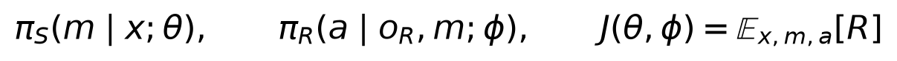

Theta and phi are shared neural parameters. The sender and receiver are policies, not messages themselves. The new learner estimates gradients from sampled choices and rewards.

Neural sharing makes generalization possible, not inevitable. We still need an information split that gives messages value, a channel that permits reusable pieces, training pressure to encode the relevant dimensions, and tests that separate memorization from reuse. The new study varies those ingredients explicitly.

# 5. The new food-and-hazard world

## 5.1 Map, food candidates and danger

The standard map is 11 columns by 10 rows, with integer x from 0 through 10 and y from 0 through 9. The collector starts at (1,4). Four public rooms contain food at (9,1), (9,3), (9,5) and (9,7). A vertical wall occupies x = 5 except at three openings: (5,1), (5,4) and (5,8). A lion and tiger occupy the first two openings in a random order. The third opening is always unguarded. The animals do not move or chase.

Each private meaning x contains target kind k, target colour c, designated animal a and free flag f. Kinds are apple, berries, grain and mushroom; colours are red, green, yellow and blue. The designated animal may be lion or tiger. If f = 1, entering that animal’s gate is dangerous. If f = 0, both are harmless. The other animal is always caged. Identity a is still a stored attribute when f = 0, although it is not necessary for immediate safe navigation then. This matters for interpreting the semantic curriculum.

```python
ARITIES = (4, 4, 2, 2)
START = (1, 4)
GOALS = ((9, 1), (9, 3), (9, 5), (9, 7))
GATES = ((5, 1), (5, 4), (5, 8))
# task.py: a gate is risky only if its animal matches the private animal
# attribute AND the private free flag is true.
guard = (animals == facts[:, 2, None]) & facts[:, 3, None].bool()
```

The four foods form a rectangular set: two kinds crossed with two colours. Suppose the target is green apple and the other kind and colour are berries and yellow. The candidates are green apple, yellow apple, green berries and yellow berries, randomly assigned to rooms. One is rewarding, but their visible appearances do not mark which. Knowing only apple or only green leaves two possibilities. The observer sees the target attributes but not the room permutation, so it cannot simply send the correct room number.


Figure 2. Exact new geometry with a held-out context-split meaning and the learned seed-0 fixed-slot message. The collector sees all candidate labels and animal positions, but the target identity and free/caged status are hidden. The blue path uses the harmless middle gate to reach green apple. The observer’s four facts are listed separately because it is not a second moving body on the map.

## 5.2 Exactly what crosses the observation boundary

| Component | Available information | Unavailable information |
| --- | --- | --- |
| Observer actor | Four private categorical attributes only | Room arrangement, public animal order, query identity, receiver actions |
| Collector actor | Message, four public kind/colour candidates, animal order, public path lengths; query index only in query games | Private target index, true target attributes, actual free/caged status |
| Central critic, training only | Private facts, public context, query and episode kind | Current sampled words and actions as input |
| Environment/scorer | All state needed to check outcomes | Not an agent; its reward calculation is not an observation |

The observation boundary is implemented by the function interfaces. speak accepts facts only. action_distributions uses candidates, swap, path lengths and the received words; it does not read batch[facts] or batch[target]. A batch object also holds private data for simulation and the critic, but that does not make it actor input. Tests change private fields while holding the message and public fields fixed and verify identical collector action distributions.

```python
# models.py
def speak(self, facts, ...):
    ...  # no room permutation or receiver query argument

def action_distributions(self, batch, words):
    logits = self.listen(words)
    cand = batch['candidates']
    # Candidate likelihood uses learned kind and colour beliefs.
    food_logits = lp[0][ids, cand[:, :, 0]] + lp[1][ids, cand[:, :, 1]]
    ...  # route policy uses public lengths and learned hazard beliefs
```

## 5.3 Actions, paths and shared return

The collector chooses a food index from four options and a passage from three options. For each pair, BFS supplies a path through the selected gate; other gates are temporarily blocked in that route calculation to ensure the selected route is actually used. Reaching the correct food gives +1; entering a free designated animal’s cell gives -1 and stops the path; each moved cell costs 0.02. A wrong food gives no terminal food bonus. The attempted opening packet costs 0.001 per payload bit, or 0.008 total.

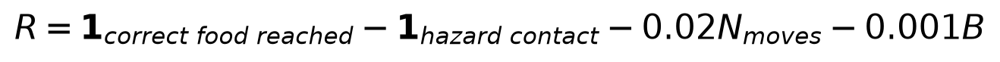

B = 8 for an enabled main protocol and B = 0 for the trained silent control. Hazard failure prevents receiving the food bonus. Both neural policies optimize the same return.

Training computes this path outcome with a vectorized formula. An independent scalar executor walks the actual path one cell at a time and sums rewards. Across all final runs, 11,520 stratified scalar paths matched the vectorized outcomes. Unit tests also check all 12 food/route choices on 64 sampled scenes. This validates the macro environment, but does not convert the planner into a learned movement policy.

At the policy level each food episode has one communication-and-decision round. At the executor level it has several movement ticks. The collector does not receive new messages while walking. There are no status changes during these new episodes. Dynamic emergency calls and two moving agents are therefore future extensions, rather than a property of these results.

# 6. What one new episode looks like

Consider target green apple, designated animal lion, free flag 1. The observer receives the integer vector [0,1,0,1]. The collector sees green apple, yellow apple, green berries and yellow berries in rooms 0 through 3; lion is at the upper gate and tiger at the middle gate. These room and animal arrangements are sampled independently of the observer’s message computation.

In the fixed-slot seed-0 model the observer emits [3,1,3,1]. The wire contains four discrete IDs, each 0 through 3. It does not contain the private vector or a continuous hidden activation. The collector embeds the words, estimates the four attributes, matches the kind and colour beliefs to the candidates, and chooses a food and gate. Here it selects food 0 and the middle gate. The planner executes 11 moves to (9,1), avoiding the free lion. Return is 1 - 0.22 - 0.008 = 0.772. This complete meaning was withheld in the context split.

| Episode event | What happens |
| --- | --- |
| Reset | Sample one allowed private meaning, two-by-two food rectangle, room permutation and animal order |
| Observe | Give the private vector only to the observer, public context only to the collector |
| Speak | Sample a word or four-word sequence from the observer policy |
| Listen | Convert the integer message into learned attribute beliefs |
| Choose | Sample food and route from the collector policy |
| Execute | Follow the supplied path; stop on hazard or final destination |
| Score | Return shared food/hazard/movement/bit reward |
| Learn, during training only | Store sampled choices and old log probabilities; apply two PPO epochs |

For a task-only training episode, the message and the food/route actions are stochastic, so the pair can discover useful conventions. For the primary evaluation, all choices are argmax and weights are frozen. The displayed successful trajectory is one example. The tables later show all five seeds and all public contexts, including errors.

```python
data = sampler.sample(512)  # sampled TRAIN meanings only
old = model.act(data)      # sampled words, food, route and query answer
task = outcome(data, old['food'], old['route'], bits=8)
reward = task['reward']    # unless this is a semantic-query episode
# The next update replays old['words'], old['food'], old['route'].
current = model.act(data, saved=old)
```

# 7. Neural learning and the nine method comparisons

## 7.1 Neural representations and a genuinely discrete wire

Each private primitive has a learned 16-dimensional embedding. The unrestricted sender concatenates four embeddings, maps them into a 64-unit hidden state and uses a recurrent GRU to generate four words autoregressively. Later words can depend on earlier sampled words. The collector uses its own word embeddings and recurrent decoder, followed by four categorical belief heads with 4, 4, 2 and 2 outputs. Integer IDs are the only episode-specific information crossing from one actor to the other.

The collector action architecture is intentionally structured. Food logits add log probabilities for a candidate’s kind and colour. Route logits use the learned animal/state beliefs and known movement costs to prefer a short safe passage. This supplies the way beliefs influence action. It is more constrained than an unrestricted recurrent navigator learning its entire controller from pixels. Both the message and its interpretation still have to be learned.

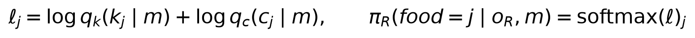

qk and qc are learned categorical beliefs decoded from the message. Candidate j is public. No true target label is used in these action logits.

The flat baseline emits one symbol from a 256-word vocabulary. Sequence methods emit four symbols from a vocabulary of four. Both permit at most eight payload bits: log2(256) = 4 log2(4) = 8. The private meaning has only six bits under a uniform full-space prior. The channel is therefore not a severe minimum-length bottleneck; it has enough capacity for a holistic code. Equal capacity also does not mean equal optimization difficulty or equal active parameter count.

## 7.2 Curriculum and regularizers

Task-only methods receive food/path reward throughout. Curriculum methods first play 600 updates of semantic query games. The collector is asked to report one randomly selected private attribute. The observer is not told which attribute is queried, so its broadcast must potentially support all four. Correct sampled answers receive reward 1 minus the packet charge. After this phase, 20% of sampled episodes remain queries and 80% are food episodes. Query labels are environmental facts, not English labels or assigned word meanings.

This is additional semantic supervision through an auxiliary game. Although the update is sampled PPO rather than cross-entropy imitation, it changes what success is rewarded for. It can encourage encoding the identity of a caged animal even when food navigation does not require that identity. Equal total episode budgets therefore give curriculum methods fewer food episodes than task-only methods. These comparisons do not isolate architecture alone.


The signalling bonus encourages varied but confident per-position word distributions. For an autoregressive sender these distributions are conditioned on sampled prefixes; this is a minibatch proxy, not exact mutual information between the entire meaning and entire message.

The signalling coefficient is 0.10. For learned slot methods a permutation penalty encourages different positions to select different facts. Independent slots learn separate sender and listener routing matrices. Aligned slots share a static learned routing matrix and its transpose; five alternating row/column normalizations make it approximately doubly stochastic. This alignment is supplied, while the order is learned. Sharing also changes normalization, so the contrast is not a perfectly isolated alignment ablation.


A is a learned static 4-by-4 position-to-attribute routing matrix, not private episode information. The factor 1/16 makes this the mean squared entry error. Its inverse direction is shared in the aligned model. The independent model sums the penalty for two separately learned row-softmax matrices.

| ID / display name | Message architecture | Learning pressure |
| --- | --- | --- |
| flat_task / Flat word | One categorical symbol, vocabulary 256 | Food/path PPO only |
| sequence_task / Sequence task | Four autoregressive symbols, vocabulary 4 | Food/path PPO only |
| sequence_curriculum | Same recurrent sequence | Query curriculum, then mixed query/food |
| sequence_signalling | Same recurrent sequence | Curriculum + signalling proxy |
| slots_signalling / Independent slots | Local heads with separate learned sender/listener roles | Curriculum + signalling + role penalty |
| tied_slots_curriculum / Aligned slots | Learned shared role order and inverse listening roles | Curriculum + signalling + role penalty |
| tied_slots_task / Aligned slots task | Same aligned architecture | Food/path + signalling + role penalty, no query games |
| modular_curriculum / Fixed slots | One fixed attribute role per position, local decoder | Curriculum + signalling; word meanings learned |
| silent_task / Silent | Constant NULL wire, no private information | Food/path PPO only |

Fixed slots is the positive compositional reference. Position 1 is assigned food kind, position 2 colour, position 3 animal and position 4 state. We did not assign which public word means apple or free, but we did provide the field separation and template. Independent and aligned slots relax that order differently. These are explicit inductive biases, not hidden discoveries to be credited to the agents.


Figure 3. Actual seed-0 sender routing matrices. Rows are word positions and columns are private attributes. A near-one entry indicates a selected field. Independent sender/listener roles can fail to agree. The aligned model supplies inverse alignment and learns an order within that template. Showing seed 0 was fixed for illustration, rather than selected as the best seed.

## 7.3 The PPO update, step by step

One update samples 512 independent training episodes. We store the actual words and collector choices, their joint log probability and a centralized value estimate. The advantage is sampled reward minus that value, normalized within the batch. The same sampled words/actions are replayed for both gradient epochs; resampling during the ratio calculation would invalidate the comparison. No gradient is backpropagated through an integer message into the other actor.

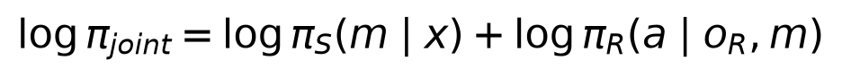

For food episodes a contains food and route, with two categorical log probabilities. For query episodes it contains the sampled answer. The sender probability includes every sampled word.

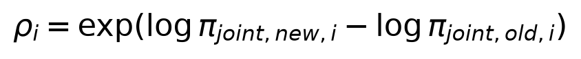

The ratio compares the new and stored joint probability of exactly the same sampled decisions.


We maximize the clipped surrogate from PPO (Schulman et al., 2017), add value fitting and entropy exploration, and include the stated regularizers. PPO is used on this one-round cooperative decision process; it need not involve a long continuous-control trajectory.

```python
ratio = (current['logp'] - old['logp']).exp()
policy = -torch.minimum(
    ratio * advantage,
    ratio.clamp(.8, 1.2) * advantage
).mean()
loss = policy + .5 * (value - reward).square().mean()
loss -= sender_entropy_weight * current['sender_entropy'].mean()
loss -= .001 * current['receiver_entropy'].mean()
# Signalling/role terms are added only for the declared methods.
optimizer.zero_grad()
loss.backward()
torch.nn.utils.clip_grad_norm_(model.parameters(), 1.)
optimizer.step()
```

Every final run uses Adam at learning rate 0.001, 1800 updates, two epochs per batch, hidden width 64 and gradient clipping 1. Sender entropy starts at 0.01 and linearly decays to zero over 70% of the budget. The receiver entropy coefficient is 0.001. The value-loss coefficient is 0.5. Both actors receive policy gradients from sampled outcomes. The critic can use private information to reduce variance because it is discarded at deployment; it cannot send the private facts to the collector actor.


Figure 4. Training diagnostics for all context-split methods, means with seed spread. The vertical line is update 600. These are sampled food-choice outcomes on current training batches, including unused food choices computed during query-only updates; they are not held-out evaluation curves. All reported test results use the final checkpoint, without best-checkpoint selection.

# 8. How we tested generalization and actual communication

## 8.1 Two separate withheld-combination splits

Each split has 48 private meanings available to the training sampler and 16 completely withheld as target meanings. Every primitive value appears in training. The context split withholds a balanced subset of four-attribute combinations while preserving all lower-order attribute pairs. The food-pair split withholds complete kind/colour pairs as rewarded targets. It is stricter for food-description reuse. These are separate training runs, not two scores from one model.


k and c range from 0 to 3; a and f range from 0 to 1. Development used seed 97 and shift 2. Final context uses shift 0 and final food-pair uses shift 1.

```python
def held_out(facts, split, shift):
    if split == 'context':
        return facts[:, 1] == (
            facts[:, 0] + 2*facts[:, 2] + facts[:, 3] + shift
        ) % 4
    return facts[:, 1] == (facts[:, 0] + shift) % 4
```

In the food-pair split, a held-out food pair may still appear publicly as a distractor during training. What is withheld is its occurrence as the observer’s rewarded target meaning. This is combination generalization under known primitive labels, not total perceptual novelty. The withheld set is small and finite; a fresh grid layout is a different kind of novelty.

## 8.2 Complete public-context evaluation and fair baselines

At evaluation we enumerate all 64 meanings, all nine choices of alternative kind/colour, all 24 room permutations and both animal layouts. That is 27,648 cases per model: 20,736 training-meaning cases and 6912 held-out cases. The training loop samples; it never calls the exhaustive evaluation generator. Nine methods times two splits times five seeds gives 90 final neural models. Each receives 921,600 sampled episode slots, for 82,944,000 total, with some slots used for query games.

The primary deployment is deterministic argmax for words and actions. Complete enumeration makes the within-model standard-map score exact for this specified distribution. Error bars describe sample standard deviation across five training seeds; they are not millions of independent experimental replications and are not significance tests. We did not discard a failed seed or tune on a final held-out score. The protocol and source hashes were frozen before these runs.

A disabled-message model is trained independently with the same seed and budget. Merely blocking a message in a trained communicating receiver is a distribution shift and may be much worse than a receiver trained to operate silently. We report both. A fully informed oracle supplies an upper reference, but it is not a learned communication baseline.

Chance is not uniformly 25% after conditioning on a held-out stratum. In the context split, a receiver with the stratum prior still has a 25% food-choice ceiling. In the food-pair split the analytic split-aware food-only ceilings are 33.3% on training meanings and 83.3% on held-out meanings; all meanings mixed give 25%. Candidate labels can reveal which kinds of target combinations are permitted in that stratum. Our silent model is trained only on the training prior and achieves 11.1% on the held-out stratum. The fixed-slot 96.7% result exceeds even the stronger 83.3% held-out food-only ceiling, but the low silent transfer score also reflects a prior shift.

## 8.3 Channel interventions

We evaluate the same frozen policies with a NULL/blocked wire, a constant all-zero message, randomly shuffled whole messages, reversed word order and a cyclic permutation of word IDs. Shuffling breaks the correspondence between a scene and its message while preserving the empirical message distribution. All attempted eight-bit packets retain their cost under these interventions. A true silent policy pays zero. The shuffle uses a seeded random permutation of full evaluation episodes, not a roll of sorted codebook rows.


Figure 5. Complete held-out context evaluation with perturbed messages. Loss under shuffling supports causal use of scene-specific message content; sensitivity to reversal and word-ID remapping supports an established positional convention. These tests alone do not prove composition. A blocked protocol is not an independently trained silent baseline.

## 8.4 Tests of reusable pieces

Exact semantic decoding counts a meaning correct only when all four learned belief heads are correct. Recombination builds a held-out message using one word per attribute copied from suitable training meanings. The attribute-to-position assignment is chosen from training meanings only by maximizing total mutual information over all 24 one-to-one assignments. A single-token edit takes a held-out message, replaces one assigned word with a donor word for a changed attribute, and checks the entire decoded meaning. The new-string rate asks whether a held-out message is absent from the sender’s training-meaning codebook.

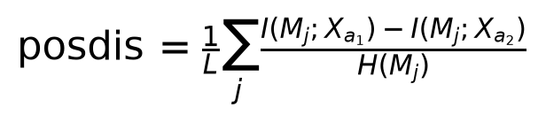

For each position j, a1 and a2 are the attributes with highest and second-highest mutual information; a constant position contributes zero. This positional disentanglement measure follows the compositionality diagnostics studied by Chaabouni et al. (2020).

Positional disentanglement can equal one even if a position collapses two attribute values. It measures purity of association, not completeness of the lexicon. We therefore require it alongside exact decoding, edits, recombination and unseen strings. Topographic similarity, also retained in the raw results, correlates Hamming distances between meanings with edit distances between messages using tied-rank Spearman correlation; it is descriptive evidence, not the sole pass criterion.

| Declared criterion | Threshold fixed before final runs |
| --- | --- |
| Effective communication | Mean training-meaning success >= 80%; every seed >= 65%; mean success drop under shuffling >= 30 percentage points; every seed return exceeds its trained silent control |
| Reliable held-out retrieval | Mean held-out success >= 95%; every seed >= 90%; zero hazard failures over all deterministic standard contexts |
| Productive compositional code | Mean exact held-out semantics, recombination and single-token edit accuracy each >= 90%; positional disentanglement >= 0.80; new held-out message rate >= 90% |

These are operational criteria for this study, not universal definitions of language. The composition criterion is based on method-level means and can pass despite an imperfect individual seed; we explicitly show that variation below. A good food score can arise from encoding only the immediately useful information and taking conservative routes, so it is not equivalent to decoding all four facts.

# 9. Complete main results


Figure 6. All nine methods on both splits. Grey bars evaluate training meanings and green bars evaluate withheld meanings, each over every public context. Error bars are standard deviation across five final seeds. The silent baseline is trained rather than obtained by ablating an already communicating model.

## 9.1 Context combinations withheld

| Method | Train success % | Held-out success % | Hazard % | Comm / retrieve / compose |
| --- | --- | --- | --- | --- |
| Flat word | 74.7 +/- 3.8 | 73.8 +/- 3.2 | 0.2% | no/no/no |
| Sequence / task | 92.8 +/- 4.5 | 80.5 +/- 1.4 | 3.0% | yes/no/no |
| Sequence / curriculum | 77.1 +/- 7.9 | 32.7 +/- 11.5 | 2.1% | no/no/no |
| Sequence / signalling | 64.2 +/- 8.4 | 31.8 +/- 14.8 | 1.5% | no/no/no |
| Independent slots | 83.2 +/- 14.5 | 78.2 +/- 20.5 | 1.1% | no/no/no |
| Aligned slots / curriculum | 96.9 +/- 4.2 | 95.8 +/- 5.9 | 0.0% | yes/no/no |
| Aligned slots / task | 96.0 +/- 4.0 | 95.0 +/- 3.5 | 0.0% | yes/yes/no |
| Fixed slots / curriculum | 98.3 +/- 3.7 | 98.3 +/- 3.7 | 0.0% | yes/yes/yes |
| Silent | 25.0 +/- 0.0 | 25.0 +/- 0.0 | 0.0% | no/no/no |

Success entries are mean +/- seed SD in percentage points. Hazard is the mean contact rate over all private meanings and public contexts. The last column applies the three prespecified criteria in the listed order; passing a food criterion does not imply passing the composition criterion.

## 9.2 Food pairs withheld

| Method | Train success % | Held-out success % | Hazard % | Comm / retrieve / compose |
| --- | --- | --- | --- | --- |
| Flat word | 75.7 +/- 3.4 | 14.3 +/- 4.2 | 0.0% | no/no/no |
| Sequence / task | 90.6 +/- 4.6 | 12.9 +/- 11.5 | 0.0% | yes/no/no |
| Sequence / curriculum | 78.9 +/- 12.3 | 19.1 +/- 2.1 | 1.6% | no/no/no |
| Sequence / signalling | 67.2 +/- 9.4 | 18.3 +/- 8.1 | 1.2% | no/no/no |
| Independent slots | 83.1 +/- 11.5 | 48.5 +/- 36.4 | 0.0% | yes/no/no |
| Aligned slots / curriculum | 93.5 +/- 5.7 | 86.7 +/- 7.5 | 0.0% | yes/no/no |
| Aligned slots / task | 100.0 +/- 0.0 | 96.7 +/- 7.5 | 0.0% | yes/no/no |
| Fixed slots / curriculum | 96.7 +/- 4.6 | 96.7 +/- 4.6 | 0.0% | yes/yes/no |
| Silent | 29.6 +/- 0.0 | 11.1 +/- 0.0 | 0.0% | no/no/no |

Success entries are mean +/- seed SD in percentage points. Hazard is the mean contact rate over all private meanings and public contexts. The last column applies the three prespecified criteria in the listed order; passing a food criterion does not imply passing the composition criterion.

Task-only recurrent sequences learned effective communication on familiar meanings: 92.8% context-split training success and 90.6% food-pair training success. However, held-out success fell to 80.5% and 12.9% respectively. This is a positive coordination result combined with a negative systematic-generalization result. Adding the tested query curriculum or per-position signalling proxy to the unrestricted sequence did not reliably fix it; both often hurt food performance at this budget.

Independent role discovery was variable. Sharing aligned roles improved generalization, and aligned task-only training reached 95.0% and 96.7% mean held-out food success. Yet it did not reliably encode all four attributes compositionally. A route can be safe without conveying every hazard detail, and selecting a visible food need not require reconstructing the whole private tuple. In the food-pair split one aligned task-only seed achieved only 83.3%, failing the minimum-seed retrieval criterion despite the high mean.

The fixed-slot curriculum reference was the strongest reliable method. It achieved 98.3% held-out context success with a worst seed of 91.7%, and 96.7% held-out food-pair success with a worst seed of 91.7%. It incurred no hazard failures in the complete deterministic standard-map evaluation. This positive result demonstrates that the sampled neural learner and discrete channel can solve the intended information problem under the stated structural support.


Figure 7. Separate tests of linguistic reuse. Values are method-level means across five seeds, from 0 to 1. Blank flat-word entries mean word-position recombination/edit tests do not apply. New strings or a high position score can coexist with failed decoding, which is why no single heatmap column suffices.

## 9.3 Did a productive code emerge?

| Split | Method | Exact facts | Recombine | Edit | New strings | Position |
| --- | --- | --- | --- | --- | --- | --- |
| context | Sequence / task | 0.250 | 0.013 | 0.050 | 0.025 | 0.166 |
| context | Independent slots | 0.588 | 0.537 | 0.581 | 0.463 | 0.771 |
| context | Aligned slots / curriculum | 0.875 | 0.875 | 0.906 | 0.800 | 1.000 |
| context | Aligned slots / task | 0.487 | 0.287 | 0.350 | 0.200 | 0.827 |
| context | Fixed slots / curriculum | 0.950 | 0.950 | 0.950 | 0.900 | 1.000 |
| food_pair | Sequence / task | 0.000 | 0.000 | 0.036 | 0.425 | 0.333 |
| food_pair | Independent slots | 0.237 | 0.350 | 0.364 | 0.450 | 0.715 |
| food_pair | Aligned slots / curriculum | 0.600 | 0.600 | 0.762 | 0.600 | 1.000 |
| food_pair | Aligned slots / task | 0.350 | 0.287 | 0.311 | 0.900 | 0.927 |
| food_pair | Fixed slots / curriculum | 0.900 | 0.900 | 0.900 | 0.800 | 1.000 |

The fixed-slot context reference reached 95% exact held-out four-fact decoding, 95% recombination, 95% single-token edit accuracy, 90% new-message rate and positional disentanglement 1.0. It passed the full method-level criterion. Four seeds were perfect on held-out four-fact decoding; one reached 75%, showing lexical collisions remained possible even with fixed roles. The food-pair reference reached 90% exact decoding, recombination and edits, but only 80% new-message rate, so it failed the complete compositional criterion.

Aligned-slot curriculum reached 87.5% exact held-out semantics and recombination in the context split, below our 90% threshold, despite positional disentanglement 1.0. On food pairs it reached 60%. Unrestricted task sequences reached only 25% exact context decoding and 0% food-pair decoding; recombination was approximately 1.25% and 0%. We therefore have evidence for an induced positional compositional code under strong supplied roles, not reliable unrestricted grammar emergence.

## 9.4 The actual learned seed-0 lexicon

| Position | Supplied role | Learned word convention, context fixed-slots seed 0 |
| --- | --- | --- |
| 1 | food kind | apple -> 3; berries -> 0; grain -> 2; mushroom -> 1 |
| 2 | colour | red -> 0; green -> 1; yellow -> 3; blue -> 2 |
| 3 | animal | lion -> 3; tiger -> 0 |
| 4 | state | caged -> 0; free -> 1 |

In this model [3,1,3,1] denotes green apple, lion free. Changing only the second token from 1 to 3 yields [3,3,3,1], which denotes yellow apple with the same lion/free information. The numeral 3 has different roles at different positions: apple in position 1, yellow in position 2 and lion in position 3. Position supplies the interpretation frame. These are learned discrete conventions within a given pair, not universal meanings attached to the IDs.

The field order was prescribed in this reference. What was learned was the local symbol-value convention and its cooperative use. We should describe this as learning a compositional vocabulary within a supplied template. The next challenge is to recover similar transfer with weaker role assumptions and across fresh partners, not merely to show another successful fixed-role seed.

# 10. Does communication behave as an optional tool?

The main content experiment always provides one opening packet. This deliberately separates learning what a message means from learning whether it should be sent. It does not establish learned sparse timing. To test a limited form of tool choice, we froze three completed protocols and trained a separate neural policy to select DIRECT, INSPECT or ASK. The tested protocols were sequence task, aligned-slot curriculum and fixed-slot curriculum, on both splits and all five seeds: 30 gates.

The gate observes only whether the target facts are already visible and the cost of inspecting. Visibility is true half the time; inspection cost is one of 0.01, 0.12 or 0.40 with equal probability. It receives no hidden facts. DIRECT uses granted facts and the planner when visible, or the independently trained silent policy when hidden. INSPECT grants exact facts at the specified cost. ASK invokes the frozen eight-bit learned message and charges an additional 0.02 request cost, so asking costs 0.028 including the reply. Inspection is an abstract acquisition action, not a physical scouting trajectory.

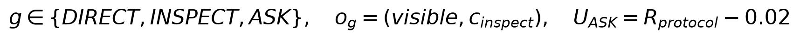

The protocol reward already includes the 0.008 reply cost. A context-only reference chooses the highest mean utility among actions for each observable visibility/cost context; it is not an omniscient per-scene gate.

The gate uses actor and critic networks with two inputs, one 32-unit tanh layer and three actor outputs. It trains for 600 PPO updates with batch 512, two epochs, Adam 0.003 and entropy 0.001. The environment can calculate branch outcomes internally, but only the sampled action’s reward enters learning. The protocol weights remain frozen. Evaluation enumerates the six observable contexts and all standard scenes.


Figure 8. Fraction of five seeds choosing ASK in each observable context. A well-calibrated gate should usually act directly when facts are known, inspect when inspection is cheap, and ask when a reliable reply is cheaper than acquiring the facts itself. Several learned gates violate these expectations.

| Split | Frozen protocol | Held-out success | Mean utility | Utility gap to context reference |
| --- | --- | --- | --- | --- |
| context | Sequence / task | 96.1% | 0.683 | 0.014 |
| context | Aligned slots / curriculum | 97.9% | 0.745 | 0.017 |
| context | Fixed slots / curriculum | 99.2% | 0.757 | 0.011 |
| food_pair | Sequence / task | 85.5% | 0.596 | 0.101 |
| food_pair | Aligned slots / curriculum | 94.4% | 0.710 | 0.029 |
| food_pair | Fixed slots / curriculum | 99.2% | 0.755 | 0.008 |

High success here can result from inspection, so it is not an independent proof that a protocol understands held-out messages. The recurrent sequence gates often learned sensible economics: inspect at low costs, ask when inspection was expensive, and act directly when informed. The better structured protocols often collapsed to ASK on all hidden cases, and some even asked when the facts were already known. These extra requests reduce utility. In the context fixed-slot condition two of five gates asked even when informed; all five asked at inspection cost 0.01, although an accurate inspection costs less than the 0.028 request-plus-reply.

We ran a disclosed follow-up on development seed 97, extending the gate to 3000 updates with the same learner and a frozen perfect development protocol. It still chose ASK in all six contexts, including known facts. We did not turn that failed pilot into a new final sweep or silently replace the 600-update results. Thus reliable economically selective tool use remains unsolved by this implementation. The original aspiration that an agent communicates only when needed is only partly addressed.

A next gate design should estimate the value of information or compare a silent rollout with a communicated rollout, while retaining sampled-policy evaluation and a strong independent silent control. Such counterfactual training supplies additional structure and must be labelled as such. Our present results justify a useful content channel; they do not justify claiming a fully learned event-triggered dialogue system.

# 11. New mazes and the bridge back to MuJoCo

## 11.1 What was actually tested in new geometry

We generated 128 public 13 x 13 obstacle layouts using a fixed seed. The start is (1,6), food locations are (11,1), (11,4), (11,8) and (11,11), and a wall at x = 6 has gates at y = 2, 6 and 10. Ten candidate random obstacle draws are cleaned of reserved cells; layouts are retained only if every food is reachable through every selected gate. The layouts and their full paths are saved, so the figure is reproducible.

All observer and collector neural weights are frozen. The public BFS adapter recomputes path lengths and the number of moves before reaching a hazard gate. The same decoded beliefs choose food and route on the new public geometry. Changing public geometry calculations is an explicit supplied adapter, not retraining. Each model is tested on all 64 meanings per layout, with fresh public candidate arrangements: 8192 scalar-executed episodes per model and 245,760 across the 30 frozen models.


Figure 9. Left: actual selected cell path from the seed-0 fixed-slot protocol on novel layout 0, with a free lion marked at the risky gate. Right: mean held-out success across the 128 new layouts, with standard deviation across five protocol-training seeds. The path planner and public geometry adapter are supplied; these results do not demonstrate learned maze exploration.

| Split | Frozen protocol | Held-out success % | All-meaning hazard rate |
| --- | --- | --- | --- |
| context | Sequence / task | 81.9 +/- 1.4 | 2.6% |
| context | Aligned slots / curriculum | 96.1 +/- 5.4 | 0.0% |
| context | Fixed slots / curriculum | 98.1 +/- 4.2 | 0.0% |
| food_pair | Sequence / task | 13.2 +/- 11.6 | 0.0% |
| food_pair | Aligned slots / curriculum | 86.9 +/- 7.4 | 0.0% |
| food_pair | Fixed slots / curriculum | 96.6 +/- 4.6 | 0.0% |

The fixed-slot protocol retained 98.1% and 96.6% mean held-out success on the new layouts, with no recorded hazard contacts. Aligned-slot curriculum retained 96.1% and 86.9%. Unrestricted sequences retained about 81.9% and 13.2%; their poor food-pair generalization did not disappear in new geometry. These scores support transfer of the learned information convention through a public navigation interface, not a claim that agents discovered efficient paths or explored around corners.

## 11.2 Why we worked outside MuJoCo

A communication failure in the full simulator can come from perception, exploration, movement control, memory, sender/listener coordination or the information structure itself. Training all of these together makes it hard to identify the cause. The structured grid removes camera and motor-learning errors, permits complete evaluation, and lets us prove that a receiver is missing useful target information. This is why it is a valuable preliminary experiment rather than a replacement for embodiment.

The transferable abstraction is a separation between environmental knowledge and local action. A message can describe green apple or lion free, while a receiver uses its own map/controller to get there safely. In MuJoCo, primitive facts must come from perception or a state estimator, candidate descriptions must refer to detected objects, and the supplied BFS route adapter must be replaced by a validated navigation policy. The reward and observation boundary should first be kept comparable so failures can be traced to the new layer.

| Current abstraction | Possible MuJoCo counterpart | Still to validate |
| --- | --- | --- |
| Food kind/colour IDs | Perceived object attributes | Robust detection and grounding, not oracle labels |
| Designated animal and state bit | Animal identity and cage/status estimator | Occlusion, uncertainty and status changes |
| Public BFS path and route lengths | Local planner or learned motor/navigation policy | Embodied execution and map errors |
| One opening packet | Opening symbolic description retained in memory | Event-triggered updates and message latency |
| Stationary observer plus collector | Mobile scout and mobile collector | Exploration, viewpoints, dialogue and shared references |

## 11.3 Your collaborative maze idea

An agent looking around a corner and reporting dead end, warning about a trap, or guiding its partner after finding food is a strong next environment. The missing ingredient here is observation history: both agents should move, each should have a limited field of view, and useful knowledge should arise from their own actions. A dynamic lion state would make an update message valuable after the opening description. These are proposed extensions, not experiments already completed in this report.

To test language more seriously, the same message should be useful across goals and actions: dead end should apply to many locations; lion free should update danger beliefs without specifying a joystick action; food left of tiger should require relational roles. Hold out combinations of object, property, relation and location, then test a receiver trained with a different navigator. This separates a reusable environmental description from a partner-specific movement command.

# 12. What we can conclude and what to try next

The new results answer the implementation question positively for effective neural communication. A private target and shared reward create a real reason to send symbols. With fixed semantic roles and a sampled query curriculum, learned words support held-out food retrieval and limited compositional recombination, and those meanings can be executed in novel public mazes through a planner. The full set of seeds and methods also shows that good coordination is easier to obtain than productive grammar.

The strongest language result is architecture-dependent. The fixed-role model supplies the decomposition and order; aligned slots supply inverse alignment; the collector has structured attribute heads and a cost-aware action interface; the query game supplies pressure to represent all attributes. We have not shown robust spontaneous grammar in unrestricted recurrent agents, nor optimal optional timing, morphology, recursion, visual grounding or two-agent exploration. The failed methods are useful findings about the tested budget and biases, rather than evidence that neural communication or grammar is impossible.

## 12.1 Recommended next experiments, not yet run

| Experiment | Change and scientific question | Required test |
| --- | --- | --- |
| Fresh partners and learners | Freeze a sender, teach a new receiver from fewer examples; compare fixed, aligned and recurrent codes | Sample efficiency and held-out combination accuracy, across new partner seeds |
| Iterated learning | Transmit a protocol through generations with a restricted learning sample, then cooperative reward | Does compositionality increase without fixing field order? Compare equal budgets and no-bottleneck controls |
| Variable-length communication | Add end-of-message and a word cost; allow shorter reports when the receiver knows some facts | Information-specific omission, economic gate utility and held-out messages, not length alone |
| Relations and roles | Add objects, locations, left/right/behind, and speaker/recipient roles | Swap subject/object or relation tokens; withhold systematic relation combinations |
| Morphological structure | Use a reusable object stem plus state or location markers, with new combinations withheld | Meaningful subword edits; compare against holistic strings and supplied-template baselines |
| Embodied partial observation | Two mobile agents, local views, traps and changing cage states | Communication gain over matched silent scouts, efficient exploration, event updates and MuJoCo transfer |

Iterated learning and signalling biases have primary research precedents (Ren et al., 2020; Eccles et al., 2019), but their published findings do not guarantee they will work in this environment. These are separate future experiments. Our code presently implements the nine methods and the two extensions described above; it does not claim to have executed the proposed next-stage experiments.

## 12.2 Cost, hardware and practical runtime

The machine exposes an NVIDIA GeForce RTX 4060 Ti and CUDA works with PyTorch 2.14.1+cu130. A development sequence run used the GPU. The final sweep used four CPU worker processes, each limited to one PyTorch thread, because the models and categorical environments are small and did not show a compelling GPU advantage in the pilots. The 90-run sweep, including per-run evaluation, took 1193.7 seconds, or 19.9 minutes of wall time. Individual recorded training time ranged from 30.0 to 68.2 seconds, with median 41.0 seconds under that concurrent load. This is not a controlled CPU/GPU benchmark and does not include development, export audits, figures or report production.

The 30 combined gate/maze jobs took 372.4 seconds, about 6.2 minutes, with three workers. The final model suite is much cheaper than visual MuJoCo training because it avoids rendering, physics and long motor rollouts. We cannot extrapolate these timings to a camera-based embodied learner.

## 12.3 Reproducibility and checks

The bundle contains runnable source, all final checkpoints with optimizer/RNG state, per-run source snapshots and hashes, logs, curves, complete 64-meaning codebooks, aggregate CSVs and per-episode action/outcome arrays. We reproduced every saved aggregate from exported frozen-policy records. The main audit covers 14,929,920 episode-condition records, including six message conditions per model. Protocol hashes match before and after extensions; both splits withhold exactly 16 meanings; no final checkpoint was selected by held-out performance.

The implementation was added under experiments/grammar_food in the existing ALKoG project, with new tests under tests/experiments/test_grammar_food.py. Existing experiments were not replaced. The full project suite passed all 161 tests, including the 18 new checks, in 45.31 seconds. The standalone bundle uses the shorter grammar_food namespace and includes a fixed sweep runner. Windows tests use MUJOCO_GL=glfw and a temporary directory in the writable workspace.

```python
# Standalone extracted bundle, from its root:
python -m pytest test_grammar_food.py -q -p no:cacheprovider
python run_study.py --output reproduced_study --workers 4
python -m grammar_food.analyze --study reproduced_study --output summary
python run_extensions.py --study reproduced_study --output reproduced_ext --layouts maze_layouts.json

# Existing ALKoG project namespace, one final-reference run:
python -m experiments.grammar_food.train --method modular_curriculum --seed 0 --split context --shift 0 --steps 1800 --warmup 600 --slot-coefficient 5 --output one_model
python -m experiments.grammar_food.evaluate --run one_model
```

Output directories must be new. The runner, not the development CLI defaults, defines the final 1800-update, 600-warm-up, slot-coefficient-5 protocol. The repository module and standalone bundle contain the same experiment functions; the top-level standalone runners use the standalone namespace. Package versions and exact configurations are stored alongside the results.

# Appendix A. Individual final seeds

Each entry below is a percentage, ordered by seed 0, 1, 2, 3, 4. This prevents an average from hiding a failed seed. Complete additional outcomes, returns, route efficiency, intervention scores and all four attribute accuracies are in the CSV/JSON data. These tables use the normal unmodified channel and final checkpoints.

## Context

| Method | Held-out food success, seeds 0-4 | Exact held-out four-fact decoding, seeds 0-4 |
| --- | --- | --- |
| Flat word | 73.8, 79.2, 71.5, 72.9, 71.5 | 6.2, 0.0, 6.2, 12.5, 0.0 |
| Sequence / task | 80.9, 82.3, 78.8, 81.2, 79.3 | 37.5, 18.8, 18.8, 31.2, 18.8 |
| Sequence / curriculum | 26.6, 35.4, 34.0, 18.1, 49.2 | 6.2, 6.2, 6.2, 0.0, 18.8 |
| Sequence / signalling | 53.8, 18.8, 34.0, 17.4, 35.2 | 18.8, 0.0, 6.2, 0.0, 6.2 |
| Independent slots | 86.2, 91.7, 60.4, 52.8, 100.0 | 68.8, 75.0, 37.5, 12.5, 100.0 |
| Aligned slots / curriculum | 91.7, 100.0, 100.0, 87.5, 100.0 | 75.0, 100.0, 100.0, 62.5, 100.0 |
| Aligned slots / task | 91.7, 95.8, 100.0, 95.8, 91.7 | 37.5, 62.5, 50.0, 43.8, 50.0 |
| Fixed slots / curriculum | 100.0, 91.7, 100.0, 100.0, 100.0 | 100.0, 75.0, 100.0, 100.0, 100.0 |
| Silent | 25.0, 25.0, 25.0, 25.0, 25.0 | 0.0, 6.2, 0.0, 0.0, 0.0 |

## Food Pair

| Method | Held-out food success, seeds 0-4 | Exact held-out four-fact decoding, seeds 0-4 |
| --- | --- | --- |
| Flat word | 12.5, 14.6, 8.3, 16.7, 19.4 | 0.0, 0.0, 0.0, 0.0, 0.0 |
| Sequence / task | 27.8, 0.0, 4.2, 20.8, 11.8 | 0.0, 0.0, 0.0, 0.0, 0.0 |
| Sequence / curriculum | 18.1, 16.7, 22.2, 18.8, 19.9 | 0.0, 0.0, 0.0, 0.0, 0.0 |
| Sequence / signalling | 15.3, 18.1, 15.6, 10.4, 31.9 | 0.0, 0.0, 0.0, 0.0, 0.0 |
| Independent slots | 70.8, 100.0, 19.4, 13.9, 38.2 | 18.8, 100.0, 0.0, 0.0, 0.0 |
| Aligned slots / curriculum | 83.3, 83.3, 83.3, 83.3, 100.0 | 50.0, 50.0, 50.0, 50.0, 100.0 |
| Aligned slots / task | 100.0, 100.0, 100.0, 83.3, 100.0 | 25.0, 50.0, 50.0, 25.0, 25.0 |
| Fixed slots / curriculum | 100.0, 100.0, 100.0, 91.7, 91.7 | 100.0, 100.0, 100.0, 75.0, 75.0 |
| Silent | 11.1, 11.1, 11.1, 11.1, 11.1 | 0.0, 0.0, 0.0, 0.0, 0.0 |

# Appendix B. Development attempts, including failures

Development used seed 97 and a separate meaning split shift of 2. Some early models used older decoder designs and sampled-context evaluation, so their scores are diagnostic and not directly comparable to the exhaustive final table. Their exact source snapshots and saved evaluation files are retained. A dash means that a full saved evaluation was not produced for that pilot; no score has been imputed from a training curve.

| Development directory | Updates | Device | Held-out food | Exact facts |
| --- | --- | --- | --- | --- |
| flat_task_cpu_97 | 1800 | cpu | - | - |
| gate_long_97 | 3000 | gate only | - | - |
| modular_bias_97 | 1800 | cpu | 100.0% | 100.0% |
| modular_long_97 | 3000 | cpu | 66.4% | 25.0% |
| plain_task_cpu_97 | 1800 | cpu | - | - |
| sequence_bias_97 | 1800 | cpu | - | - |
| sequence_initial_97 | 800 | cpu | 24.6% | 12.5% |
| sequence_long_97 | 3000 | cpu | 50.6% | 12.5% |
| sequence_task_cuda_97 | 1200 | cuda | 89.6% | 18.8% |
| silent_gate_97 | 600 | cpu | - | - |
| slots_bias_97 | 1800 | cpu | - | - |
| tied_context_97 | 1800 | cpu | 84.0% | 56.2% |
| tied_food_97 | 1800 | cpu | 75.0% | 25.0% |
| tied_pure_97 | 1800 | cpu | 75.0% | 25.0% |

Early recurrent curriculum runs did not reliably learn the intended code even when extended to 3000 updates. A modular sender with an older recurrent collector also struggled. Local modular decoding plus signalling produced a perfect development protocol, motivating the fixed-slot reference. Independent slot routing remained fragile; increasing the role penalty and supplying aligned inverse routing improved it. The final nine-method protocol was frozen after this development stage, then all five final seeds were run. The later 3000-update gate pilot is explicitly labelled as post-main development and retained as a failure.

# Appendix C. Code map and mathematical details

| File in standalone bundle | Responsibility |
| --- | --- |
| grammar_food/task.py | Meaning space, split masks, sampled public contexts, exact evaluation contexts, BFS paths, scalar and vectorized reward |
| grammar_food/models.py | Private encoder, integer message sampling, listener beliefs, slot routing, collector choices and centralized critic |
| grammar_food/train.py | Sampled joint PPO, semantic query schedule, regularizers, checkpoints and source snapshots |
| grammar_food/evaluate.py | Frozen deterministic evaluation, message interventions, semantic codebook, MI, edits and recombination |
| grammar_food/optional_tool.py | Frozen-protocol DIRECT / INSPECT / ASK gate |
| grammar_food/transfer.py | Novel public obstacle maps, geometry adapter and scalar path execution |
| grammar_food/export_records.py | Raw frozen actions/outcomes, aggregate matching and stratified scalar checks |
| test_grammar_food.py; verify_study.py | Information boundaries, split/replay/gradient/reward/path tests and retained-artifact audit |
| earlier/first-grid.py; earlier/four-tasks.py | Archived earlier implementations explained in Sections 2 and 3 |

A learned route policy uses the probabilities q(a | m) and q(free | m). For a guarded gate, estimated danger is their product for its public animal identity; the third gate has estimated danger zero. Expected movement cost mixes the public full route length with the number of steps before the guard. Its categorical route logits multiply predicted utility by inverse temperature 25. This cost-aware action form is supplied, and the semantic probabilities are learned.

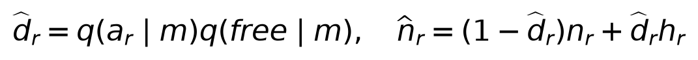

nr is public path length; hr is the public prefix length to the gate. Standard-map h is 7 for the upper gate and 4 for the middle gate. New-map transfer recomputes these prefixes.


This is the exact supplied route scoring form. It assumes the chosen food is correct when forming the +1 versus -1 risk tradeoff, although the actual environment scores a wrong food as zero. It encourages safety from learned beliefs and is not an unrestricted learned route controller.

The centralized critic has 62 inputs: 12 one-hot private primitive indicators; 32 public food-candidate indicators; one animal-order bit; four query indicators; one query-game flag; and 12 normalized public path lengths. It never observes current sampled messages or selected actions as inputs. Stored parameter counts include unused modules shared across method implementations; the configurations also record the number of parameters receiving a nonzero gradient at the last update. Equal message capacity and width do not equalize effective model size.

| Method, context seed 0 | Stored params | Last-update gradient params | Query episodes | Food episodes |
| --- | --- | --- | --- | --- |
| Flat word | 70889 | 33437 | 0 | 921600 |
| Sequence / task | 46445 | 41137 | 0 | 921600 |
| Sequence / curriculum | 46445 | 41137 | 430116 | 491484 |
| Sequence / signalling | 46445 | 41137 | 430116 | 491484 |
| Independent slots | 46445 | 9677 | 430116 | 491484 |
| Aligned slots / curriculum | 46445 | 9661 | 430116 | 491484 |
| Aligned slots / task | 46445 | 9661 | 0 | 921600 |
| Fixed slots / curriculum | 46445 | 9645 | 430116 | 491484 |
| Silent | 46445 | 17549 | 0 | 921600 |

Topographic similarity and positional disentanglement use the full uniform 64-meaning codebook as post-training diagnostics. Only the attribute-to-position assignment for recombination/edit tests is fit on the 48 training meanings. No gradient uses these language metrics. A sequence with distributed semantics may score poorly on this positional test despite having other structure; stronger claims would require additional grammar-specific probes and larger meaning spaces.

# Appendix D. References and evidence boundary

Schulman et al. (2017), Proximal Policy Optimization Algorithms. The clipped sampled-policy objective used here follows this family of methods. https://arxiv.org/abs/1707.06347

Chaabouni et al. (2020), Compositionality and Generalization in Emergent Languages. This motivates separate generalization and compositionality diagnostics, including positional disentanglement. https://aclanthology.org/2020.acl-main.407/

Eccles et al. (2019), Biases for Emergent Communication in Multi-agent Reinforcement Learning. This motivates explicitly studying communication biases; our per-position proxy is not a reproduction of every method in that paper. https://arxiv.org/abs/1912.05676

Ren et al. (2020), Compositional Languages Emerge in a Neural Iterated Learning Model. This supports the proposed iterated-learning direction, which has not been implemented in the current study. https://arxiv.org/abs/2002.01365

All performance values in this document are local experimental results, not claims derived from these papers. The earlier source files and reports are retained for the historical explanation. The main protocol hash is 4e1c002cb36d31b56d8e9b57a3d6ece09ad2c10bb74911a9652bcd3a42809fbb. Five seeds and 64 possible meanings are a limited research setting. The positive conclusion is effective neural communication and induced positional composition under the stated assumptions; the remaining failures are part of the finding.