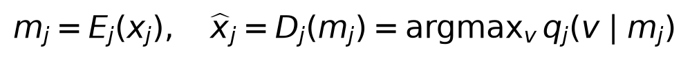
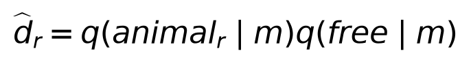
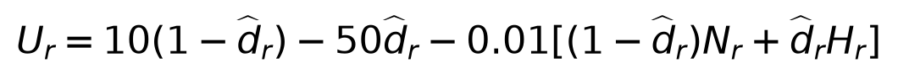
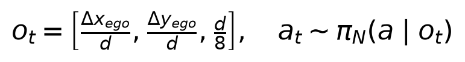
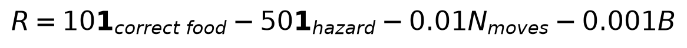
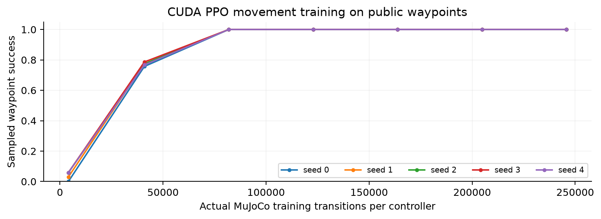

# Fixed slot neural communication in the MuJoCo arena

ALKoG integration and controlled transfer study. November 16, 2026. This addendum tests the strongest existing fixed-slot neural protocol in the existing troy_dev arena implementation. It keeps the original transfer failures separate from a training-only deployment check. New grammar and syntax induction methods remain deferred.

## What happened

The message network transfers to actual MuJoCo scene execution. After a training-only protocol admission check, the validated deployment pipelines achieved 100.0% held-out food retrieval in the context split and 100.0% in the food-pair split. The transformed-layout results were 100.0% and 100.0% respectively. Every individual pipeline and all failed retraining attempts are retained.

The unfiltered zero-shot result was also strongly positive for useful communication, but failed one strict reliability requirement: an original source checkpoint achieved only 89.6% on held-out context meanings. Its destination choices were already wrong before movement. The motor controller executed correct destination-and-safe-route choices reliably. We therefore added a check for correct interpretation of training meanings before admitting a protocol for deployment, rather than hiding the failed source checkpoint.

This is an exact-state, kinematic MuJoCo transfer with supplied public route waypoints and a learned movement controller. The sender/listener retain the supplied four semantic roles. There is no camera-perception result, newly induced grammar, learned route planner, dynamic animal pursuit or torque-controlled locomotion in this study.


Figure 1. Actual saved-trajectory replay in the existing MuJoCo arena. The same held-out green-apple/lion-free scene is shown with a correct opening packet, the trained silent control, and only the state word inverted. The first obtains food; the second chooses the wrong food; the third enters the free lion. The example is selected by an explicit illustration rule, not used as the performance estimate. A downloadable animated replay accompanies this report.

# 1. What was integrated

The new FoodArena class subclasses the repository’s CommunicationKGWorldEnv. It extends the original kg_world.xml scene asset and invokes the inherited receiver movement method. Both original files remain byte-identical. The arena still contains the original camera-bearing observer, yellow receiver, lion and cage geometry. The extension adds a tiger, four public food candidates and three passages through a wall. MuJoCo holds and updates the scene and body poses at every movement step.

The original movement method changes the receiver position by a small displacement relative to its own yaw and calls mujoco.mj_forward. It does not integrate forces using torque actuators. Since those kinematic moves bypass contact response, the extension rejects wall-crossing segments geometrically and checks swept hazard/food encounters. Calling this a MuJoCo arena test is accurate; calling it physical locomotion or a real-world robot test would be inaccurate.

```python
class FoodArena(CommunicationKGWorldEnv):
    def _apply_action(self, action):
        old = self.receiver_xy
        super()._apply_action(action)  # original displacement + mj_forward
        new = self.receiver_xy
        self.bump = self._blocked(old, new)
        if self.bump:
            self._place('receiver', old)
            mujoco.mj_forward(self.model, self.data)
```

The base map starts the receiver near (-4.8,-0.6) metres. The four foods are at x = 4.8, with y = -4.2, -1.8, 0.6 and 3.0. A vertical wall at x = 0 has passages at y = -4.2, -0.6 and 4.2. Lion and tiger occupy the first two passages in a random order; the third is unguarded. Food kind/colour labels are shuffled among the public positions. Wrong-food contact terminates without the reward, so the collector cannot simply collect every candidate in one episode.

For each scene, the target food has one of four kinds and four colours, and one designated animal has a caged/free state. The other animal is caged. This preserves the original private meaning space of 4 x 4 x 2 x 2 = 64 combinations. The observer gets the four private attributes; the collector gets candidate labels, animal positions and public geometry. The collector does not get the true target index or true animal state.

The candidate generator selects one alternative kind and one alternative colour, then forms all four combinations of the two kinds and two colours. For example, green apple can appear with blue apple, green grain and blue grain. The four distinct labels are shuffled among the rooms. Knowing only the kind or only the colour leaves two candidates. Foods use different simple shapes for kinds and different tints for colours in the rendered scene, while the policies receive the exact categorical labels.

| Component | Input and responsibility | What is learned or supplied |
| --- | --- | --- |
| Observer neural policy | Private kind, colour, animal and state; emits four integer symbols once | Learned word meanings; supplied position roles |
| Listener and macro choice | Integer words plus public candidates and geometry; choose food and passage | Frozen learned neural beliefs; supplied belief-to-action scoring |
| Public route interface | Selected food/passage and public scene geometry | Supplied passage/food polylines and interpolation |
| Movement neural policy | Egocentric direction and distance to the current public waypoint | PPO-trained four-action control; no private facts |
| MuJoCo arena | Actual receiver displacement, wall/hazard/food checks and terminal reward | Existing kinematic movement plus explicit swept checks |

# 2. One packet and many movement steps

The strongest source model, modular_curriculum, has a neural sender and local neural listener heads. It sends four symbols from a vocabulary of four: eight payload bits. The supplied roles are food kind, colour, animal identity and state. Actual token meanings were learned by the original sampled PPO procedure; no English word dictionary was assigned by hand. The arena integration does not change these roles or introduce another grammar-induction mechanism.



At deterministic deployment, E is the sender choice, q is a learned categorical belief and D is the listener argmax. Each position has a supplied attribute role. The wire contains integer IDs, not private facts or hidden continuous activations.

After the opening packet, the collector chooses a destination and passage from its decoded beliefs. It keeps that choice while navigating. The observer does not issue joystick commands at each timestep. The public route interface supplies a sequence of waypoints through the selected passage and toward the selected food, and the movement policy chooses each physical displacement. There are no mid-episode status changes or learned send/no-send decisions in this transfer.

The macro action score matches food kind/colour beliefs to the four public candidates. It estimates each guarded passage’s danger using the learned animal and free-state probabilities. Public route lengths and prefix lengths are converted to approximate movement steps. The arena’s food and hazard costs then score candidate routes. Actual success is still determined by the executed trajectory, not by this estimate.



The third passage has estimated danger zero. Neither true state nor true target is read by this deployed score.



Nr estimates the full public route length in movement steps; Hr estimates the prefix to the guarded passage. The risk-aware scoring form is supplied rather than learned route planning.

For the original seed-0 context protocol, [3,1,3,1] denotes green apple with lion free. In the demonstration, replacing only the last word with its learned caged counterpart gives [3,1,3,0]. Food information is unchanged, but the collector takes the dangerous passage. This is a causal test of the learned state word under the existing positional convention.

# 3. What the GPU learned

Five independently initialized waypoint controllers were trained on the NVIDIA GeForce RTX 4060 Ti using CUDA PyTorch. Each received 60 PPO updates, 32 parallel MuJoCo arenas and 128 consecutive steps per rollout: 245,760 actual transitions per seed and 1,228,800 total. These are ordered MuJoCo movement transitions, not a table of expected communication rewards. Each controller was paired with both source meaning splits, keeping movement constant across channel controls.

The controller has separate actor and critic networks, each with two tanh layers of width 64. Its three inputs are the two components of the waypoint’s unit direction in the receiver’s yaw frame and its distance divided by eight. The actor outputs four cardinal actions in that local frame. It does not see the target label, animal state, received words, reward history or camera pixels. The selected waypoint is public information produced by the collector’s own macro choice.



Direction is normalized with a small numerical floor. Movement is 0.2 m per chosen action. The action changes the actual receiver body position through the inherited arena method.


Motor pretraining uses open-space public waypoints with task objects and walls parked, so its wall-bump term is zero. It supplies no hidden food identity through progress shaping. Safe public routes are supplied at deployment; wall avoidance is not learned from these training episodes.



B = 8 for an attempted packet, including corrupted/blocked packets. The independently trained silent and fully informed oracle controls use B = 0. Any wrong food or hazard encounter terminates the episode; the horizon is 180 moves.

Training uses Adam at 0.0005, four PPO epochs, minibatches of 1024, clip range 0.8 to 1.2, gradient clipping 0.5, discount 0.99 and GAE lambda 0.95. Time-limit endings bootstrap their final state value while cutting advantage propagation before the reset episode. Terminal goal events do not bootstrap. No movement teacher or action labels were used. Public route interpolation remains an explicit scaffold.



Figure 2. Sampled waypoint success during CUDA PPO training for all five movement seeds. These are training diagnostics on local navigation, not held-out food-retrieval curves. All primary evaluations use the final controller checkpoint.

# 4. Development failures were retained

Development used seed 97 and separate scene seed 93000017. The first open-space controller reached all 256 diagnostic waypoints, yet sparse arena waypoints let it drift into passage walls and stall. Adding close passage waypoints eliminated stalls but still allowed wide paths toward distant waypoints to touch a distractor food. Interpolating the complete public polyline bounded this deviation. All variants and their failed trajectories remain in the download.

| Development variant | What failed | Held-out pilot outcome |
| --- | --- | --- |
| Sparse public waypoints | Wall stalls despite correct messages and good open-space movement | 90.6% success on each geometry family; 9.4% timeouts |
| Dense passage points only | Some paths touched the wrong food before reaching the selected destination | 98.4% success; no sampled timeouts or hazards |
| Complete public polyline interpolation | No remaining execution errors in the development sample | 100% success on both sampled geometry families |

The final route interface interpolates public segments at no more than 0.35 local metres, with a 0.18 m waypoint tolerance. The learned controller still selects every 0.2 m move; positions are never teleported to waypoints. This improves execution of a supplied route, not the emergence of an autonomous path-planning algorithm. Final navigation seeds, scene seed and test protocols were frozen after these development checks.

# 5. Final tests and their controls

Each source split retains its original 48 training meanings and 16 withheld complete meanings. The context split withholds combinations of kind, colour, animal and state. The food-pair split withholds rewarded target kind/colour pairs; these pairs may still have appeared as public distractors in the original training. Every primitive value is represented among the training meanings.

For every pipeline and geometry family, we tested all 64 meanings with 32 fresh public contexts each: 2048 episodes per condition, including 512 held-out-meaning episodes. Standard layouts vary scale from 0.95 to 1.05 and translate by up to 0.25 m. Transformed layouts use 90, 180 or 270 degree rotations, scale 0.85 to 1.15 and translation up to 0.45 m. Receiver yaw is independently randomized. The scene families reuse the three-passage topology; they are not arbitrary unseen mazes.

| Condition | What changes |
| --- | --- |
| Normal | Original scene-specific opening packet |
| Silent | Independently trained silent high-level policy, with the same learned movement controller |
| Oracle | Exact private facts granted directly; the same route interface and learned movement controller |
| Shuffle | Whole packets randomly reassigned between scenes |
| Blocked | All four word positions replaced with the NULL ID |
| Reverse | The four word positions are reversed |
| Invert state | Only the state-position token is replaced with the sender’s token for the opposite state |

This is a paired design: conditions use exactly the same scenes, candidate layouts, receiver yaws and motor weights. The silent model was trained to operate without private messages; simply blocking the communicating model would be a weaker baseline. The oracle is a privileged control that separates motor failure from message interpretation failure. Packet cost remains charged for message interventions.

Both the original frozen study and the fresh-scene admitted study contain 286,720 executed episodes. Scores are means and sample standard deviations across five pipeline seeds. Episodes sharing a trained model are not independent training replications. Finite zero-hazard counts provide observed evidence in this setting, not a general safety guarantee.

| Criterion | Fixed requirement |
| --- | --- |
| Effective communication | Every paired pipeline improves return over its silent control; mean normal-minus-shuffled success >= 30 percentage points |
| Reliable transfer | Mean held-out success >= 95%; every pipeline >= 90%; no normal-channel hazard contacts, separately for each split and geometry family |
| Execution fidelity | Each normal and oracle pipeline succeeds on >= 99% of cases where it selected the correct food and a safe passage |

# 6. Original frozen protocols in MuJoCo

| Split | Geometry | Normal success % | Worst pipeline | Silent success % | Execution fidelity | Reliable criterion |
| --- | --- | --- | --- | --- | --- | --- |
| context | standard | 97.9 +/- 4.6 | 89.6% | 24.3 +/- 0.5 | 100.0% | False |
| context | transformed | 97.9 +/- 4.6 | 89.6% | 24.3 +/- 0.5 | 100.0% | False |
| food_pair | standard | 96.7 +/- 4.5 | 91.6% | 10.9 +/- 1.0 | 100.0% | True |
| food_pair | transformed | 96.7 +/- 4.5 | 91.6% | 10.9 +/- 1.0 | 100.0% | True |

The original frozen code was useful, and correct macro choices were faithfully executed. However, a context source checkpoint confused some target values: its 89.6% held-out success was below the 90% individual threshold. The same rate appears in its correct-food choice metric, while movement fidelity is 100%. This is a source lexical error carried into the arena, rather than a motion-control failure. We did not relabel this initial study as fully reliable.


Figure 3. Initial frozen transfer and separately tested admitted deployments. Error bars are standard deviation across five pipeline seeds. Grey versus green shows the effect of a disclosed training-only deployment check, not new grammar induction or selection on the fresh held-out test. Blue bars show trained silent controls on the corresponding scene sets.

A low silent score on food-pair held-out meanings also reflects a changed target prior. Under the full specified distribution, the analytic split-aware food-only ceiling is 25% for context meanings and about 83.3% for held-out food pairs. The latter reference knows the held-out-pair prior, unlike a silent model trained on the original training prior. The admitted message system exceeds this stronger food-only reference as well. Neither the grid nor this arena proves that communication is necessary in every possible task design.


Among the nine possible two-by-two candidate rectangles around a held-out target pair, one third contain a second valid held-out pair. A receiver that knows the test-stratum prior can choose perfectly in the other two thirds, and can only guess between two equally likely targets in the remaining third. Geometry is independent of target identity.

# 7. Training-only admission and the unchanged learning method

After observing the initial source failure, we fixed a separate follow-up protocol. A source code was admitted only if it decoded all four facts correctly on all 48 training meanings. The 16 held-out meanings were not forwarded through the model during selection. Already admissible original checkpoints were kept. Failed checkpoints were retrained from scratch with exactly the same fixed-slot architecture, signalling bonus, semantic curriculum and PPO procedure as before; CUDA was used for these retries. This is an explicit engineering acceptance filter, not a new method for inducing grammar.

Retry seeds were fixed as 1000 times the attempt number plus the original pipeline ID, for at most three attempts. We accepted the first training-admissible result, retained every failure and counted all training costs. The original silent protocols and original trained motor controllers were reused. A fresh evaluation scene seed, 94000019, was fixed for the follow-up, while the initial test used 93000019. The initial failed result remains a separate table and dataset.

| Split | Pipeline ID | Original training decoding | Retry initialization and training decoding |
| --- | --- | --- | --- |
| context | 0 | 100.0% | Original kept |
| context | 1 | 75.0% | seed 1001: 75.0%; seed 2001: 100.0% |
| context | 2 | 100.0% | Original kept |
| context | 3 | 100.0% | Original kept |
| context | 4 | 100.0% | Original kept |
| food_pair | 0 | 100.0% | Original kept |
| food_pair | 1 | 100.0% | Original kept |
| food_pair | 2 | 100.0% | Original kept |
| food_pair | 3 | 75.0% | seed 1003: 100.0% |
| food_pair | 4 | 75.0% | seed 1004: 75.0%; seed 2004: 100.0% |

Seven of the ten original communication checkpoints passed immediately. Three required retries. There were 5 additional training attempts in total, including 2 failed attempts. Each attempt used 1800 updates of batch 512, so the total additional abstract communication-training budget was 4,608,000 sampled episodes. These are abstract semantic-query/food episodes, separate from the actual MuJoCo movement-training transitions. Pipeline IDs are retained for pairing; actual new initialization seeds are recorded separately.


Because the supplied encoder and decoder are local by attribute, perfect deterministic interpretation of every primitive value composes to every complete meaning. All primitive values occur in the 48 training meanings. This structural implication explains why the admission test is strong; it is not evidence for discovering an unrestricted grammar.

The follow-up estimates the performance of a validated deployment pipeline with retraining costs, not the probability that a single unfiltered PPO initialization learns a perfect code. This distinction matters: retrying until training is correct is a practical quality check, and its cost and failures must remain visible. No held-out score was used to choose a retry or change a symbol meaning.

# 8. Fresh-scene results after admission

| Split | Geometry | Normal success % | Worst pipeline | Hazard rate | Timeout rate | Communication / reliability / execution |
| --- | --- | --- | --- | --- | --- | --- |
| context | standard | 100.0 +/- 0.0 | 100.0% | 0.0% | 0.0% | pass/pass/pass |
| context | transformed | 100.0 +/- 0.0 | 100.0% | 0.0% | 0.0% | pass/pass/pass |
| food_pair | standard | 100.0 +/- 0.0 | 100.0% | 0.0% | 0.0% | pass/pass/pass |
| food_pair | transformed | 100.0 +/- 0.0 | 100.0% | 0.0% | 0.0% | pass/pass/pass |

The admitted protocols are evaluated as frozen models on these fresh scenes. There is no joint fine-tuning of communication from arena reward, and no movement retraining after the original final study. The result therefore establishes transfer of a validated learned code through the supplied route interface to a learned kinematic controller. It does not establish that communication and visual motor control emerge together end to end.

High retrieval success does not imply shortest-path or optimal-return behaviour. Uncertain learned beliefs can select a conservative passage, and the public route scaffold introduces waypoint corrections. Returns and movement lengths are retained alongside success; the fully informed oracle uses the same learned movement controller as the communicating and silent arms.


Figure 4. Fresh-scene channel controls. Normal packets succeed much more often than independently trained silent, shuffled, blocked or reversed packets. State-word inversion preserves food content but can change passage safety. These interventions support causal use of learned message content in the arena.

## Context control details

| Condition | Geometry | Food success % | Hazard rate % | Mean return |
| --- | --- | --- | --- | --- |
| normal | standard | 100.0 +/- 0.0 | 0.0 +/- 0.0 | 9.292 |
| normal | transformed | 100.0 +/- 0.0 | 0.0 +/- 0.0 | 9.295 |
| silent | standard | 25.6 +/- 0.9 | 0.0 +/- 0.0 | 1.556 |
| silent | transformed | 25.6 +/- 0.9 | 0.0 +/- 0.0 | 1.555 |
| oracle | standard | 100.0 +/- 0.0 | 0.0 +/- 0.0 | 9.300 |
| oracle | transformed | 100.0 +/- 0.0 | 0.0 +/- 0.0 | 9.303 |
| shuffle | standard | 21.9 +/- 0.3 | 20.6 +/- 1.3 | -8.755 |
| shuffle | transformed | 22.1 +/- 0.3 | 20.2 +/- 1.2 | -8.499 |
| blocked | standard | 24.8 +/- 0.9 | 1.7 +/- 2.6 | 0.656 |
| blocked | transformed | 24.8 +/- 0.9 | 2.0 +/- 2.9 | 0.524 |
| reverse | standard | 19.7 +/- 3.3 | 23.3 +/- 2.5 | -10.295 |
| reverse | transformed | 19.6 +/- 3.3 | 23.6 +/- 2.3 | -10.417 |
| invert_state | standard | 79.9 +/- 0.0 | 20.1 +/- 0.0 | -2.702 |
| invert_state | transformed | 79.9 +/- 0.0 | 20.1 +/- 0.0 | -2.703 |

## Food Pair control details

| Condition | Geometry | Food success % | Hazard rate % | Mean return |
| --- | --- | --- | --- | --- |
| normal | standard | 100.0 +/- 0.0 | 0.0 +/- 0.0 | 9.290 |
| normal | transformed | 100.0 +/- 0.0 | 0.0 +/- 0.0 | 9.289 |
| silent | standard | 9.9 +/- 0.9 | 0.0 +/- 0.0 | -0.009 |
| silent | transformed | 9.9 +/- 0.9 | 0.0 +/- 0.0 | -0.011 |
| oracle | standard | 100.0 +/- 0.0 | 0.0 +/- 0.0 | 9.298 |
| oracle | transformed | 100.0 +/- 0.0 | 0.0 +/- 0.0 | 9.297 |
| shuffle | standard | 20.7 +/- 3.4 | 19.2 +/- 0.9 | -8.184 |
| shuffle | transformed | 20.6 +/- 3.3 | 19.5 +/- 0.8 | -8.347 |
| blocked | standard | 22.4 +/- 8.9 | 5.9 +/- 7.0 | -1.577 |
| blocked | transformed | 22.3 +/- 8.9 | 6.2 +/- 6.9 | -1.772 |
| reverse | standard | 19.3 +/- 3.0 | 20.2 +/- 1.9 | -8.794 |
| reverse | transformed | 19.1 +/- 2.8 | 20.5 +/- 1.7 | -8.948 |
| invert_state | standard | 79.3 +/- 0.0 | 20.7 +/- 0.0 | -3.055 |
| invert_state | transformed | 78.7 +/- 0.0 | 21.3 +/- 0.0 | -3.403 |

# 9. What the safety word does

The inverted-state intervention changes exactly one position of the learned code. The true world and the food words are unchanged. For a free lion, the altered packet may tell the listener the animal is caged, making a short guarded passage attractive. For a caged animal, the altered packet may cause an unnecessary detour. The intervention’s success loss and hazard increase therefore test state information separately from whether the food target is identified.


Figure 5. Hazard contacts under normal, inverted-state and shuffled packets in the admitted fresh-scene study. Rates are means over five pipeline seeds. The normal channel has the observed hazard rate shown in the table; corrupted information can create hazards even with the same reliable movement controller.

The replay uses original context pipeline 0 and the first held-out green-apple/lion-free scene in which state inversion causes hazard contact, scene index 162. This selection rule is recorded. In the saved normal trace, [3,1,3,1] leads to the food. Inverting the final word gives [3,1,3,0] and causes a hazard. The independently trained silent control chooses a different food. The animation renders actual saved policy-generated positions through MuJoCo; it is a visual explanation, not additional evaluation evidence or proof from one hand-picked success.

# 10. Independent verification and actual costs

All 175 project tests passed in 48.15 seconds. The 12 new arena tests cover inherited MuJoCo body updates, swept walls in four orientations, passage crossing, free/caged hazard handling, wrong-food termination, private-information isolation, public-length transform invariance and time-limit/terminal GAE behaviour. Two new admission tests verify that the model sees only 48 training meanings and still sees every primitive value. These 14 checks are included in the full project suite.

A separate trajectory auditor checked 245,760 retained normal/oracle/inverted-state episodes and 16,659,079 movement steps across both studies. It independently recomputed swept wall blocking, actual displacement, food/hazard encounters, terminal priority, timeouts and every reward, without calling the environment’s step or scoring helpers. It also replayed 180,759 stratified actor decisions from the saved trained weights. All checks passed. Message, silent and navigation checkpoint hashes remained unchanged throughout each frozen evaluation.

| Measured item | Value |
| --- | --- |
| GPU | NVIDIA GeForce RTX 4060 Ti; torch 2.14.1+cu130 |
| Five navigation runs | 93.7 seconds total recorded training; range 18.5-18.8 seconds/run |
| Navigation training transitions | 1,228,800 |
| Additional protocol retry training | 351.3 seconds across 5 CUDA attempts |
| Initial study wall time | 23.3 minutes |
| Admitted study wall time | 27.7 minutes, including its initial wait for admission |
| Total executed evaluation episodes | 573,440 |
| Total evaluation movement steps | 42,716,009 |

The two studies and protocol retries partially overlapped, so their wall times should not be added as a total task duration. Timing excludes code development, rendering, report production and much of the independent audit. CUDA runs the neural PPO updates and batched motor inference; the existing native MuJoCo scene updates and geometry checks remain on CPU. These small exact-state tasks are much faster than a future camera-based training pipeline.

# 11. Individual pipeline scores

The following entries are percentages for pipeline IDs 0, 1, 2, 3 and 4, in order. The admitted pipelines reuse the original motor controllers and silent controls. Some source communication networks have new initialization seeds, as disclosed in Section 7; the rows are not ten new independent training replications.

| Stage | Split | Geometry | Held-out food success, IDs 0-4 | Conditional execution fidelity, IDs 0-4 |
| --- | --- | --- | --- | --- |
| Frozen originals | context | standard | 100.00, 89.65, 100.00, 100.00, 100.00 | 100.00, 100.00, 100.00, 100.00, 100.00 |
| Frozen originals | context | transformed | 100.00, 89.65, 100.00, 100.00, 100.00 | 100.00, 100.00, 100.00, 100.00, 100.00 |
| Frozen originals | food_pair | standard | 100.00, 100.00, 100.00, 91.99, 91.60 | 100.00, 100.00, 100.00, 100.00, 100.00 |
| Frozen originals | food_pair | transformed | 100.00, 100.00, 100.00, 91.99, 91.60 | 100.00, 100.00, 100.00, 100.00, 100.00 |
| Training-admitted | context | standard | 100.00, 100.00, 100.00, 100.00, 100.00 | 100.00, 100.00, 100.00, 100.00, 100.00 |
| Training-admitted | context | transformed | 100.00, 100.00, 100.00, 100.00, 100.00 | 100.00, 100.00, 100.00, 100.00, 100.00 |
| Training-admitted | food_pair | standard | 100.00, 100.00, 100.00, 100.00, 100.00 | 100.00, 100.00, 100.00, 100.00, 100.00 |
| Training-admitted | food_pair | transformed | 100.00, 100.00, 100.00, 100.00, 100.00 | 100.00, 100.00, 100.00, 100.00, 100.00 |

# 12. Scope of the conclusion and deferred work

The integration works as a controlled exact-state transfer: learned discrete words can select food and a safe passage, and a CUDA-trained neural controller can execute those decisions in the existing MuJoCo arena. A training-only admission check makes the inherited fixed-role code suitable for this validated deployment, while the original single-start failures remain visible. This is the completed integration result supported by these experiments.

The supplied ingredients remain substantial: primitive observations, semantic position roles, belief-to-action scoring, public route waypoints, and collision/outcome rules for kinematic movement. The collector does not learn to explore a maze or infer its own map. The observer does not learn visual grounding. There is one supplied opening packet; optional timing and dynamic emergency messages are not established. Animals are static visual markers with state flags, not moving predators, and cage meshes do not provide a physical contact-solver containment experiment.

New grammar and syntax induction methods have not been started. The supplied role structure remains exactly the one used by the strongest earlier implementation. The next research decision can therefore build on a working, explicitly bounded arena integration without mixing that validation with a new language-learning mechanism.

# 13. Files and reproduction

The new repository module is experiments/grammar_arena, with tests in tests/experiments/test_grammar_arena.py. Existing arena code and assets were left unchanged. The downloadable bundle contains the runnable project subset, the frozen protocols and quality-control plan, original and admitted source checkpoints, all movement checkpoints, failed development variants, all episode/scenes records, audited trajectory files, complete logs, plots, the report and the animation.

```python
# From the project/ directory in the extracted bundle:
python -m experiments.grammar_arena.study --source-study ../source_protocols --protocol ../protocol.json --output ../new_zero_shot --workers 3

# From the bundle root, same learning method plus training-only admission:
python calibrate_protocols.py --source source_protocols --output new_admission
python run_admitted.py --quality new_admission --first-study new_zero_shot --source-study source_protocols --output new_admitted --workers 2

python audit_trajectories.py --study new_zero_shot --output new_audit.json
python analyze.py --study new_zero_shot --output new_summary
```

Use new output directories. The repository copy runs the same module commands from troy_dev_ppo_communication_gumbel; supply explicit protocol/checkpoint paths. The source bundle includes Python package versions and hashes. Reproducing the full study needs the installed CUDA PyTorch environment; reading the report or watching the GIF does not. A standalone HTML report is provided alongside the PDF.