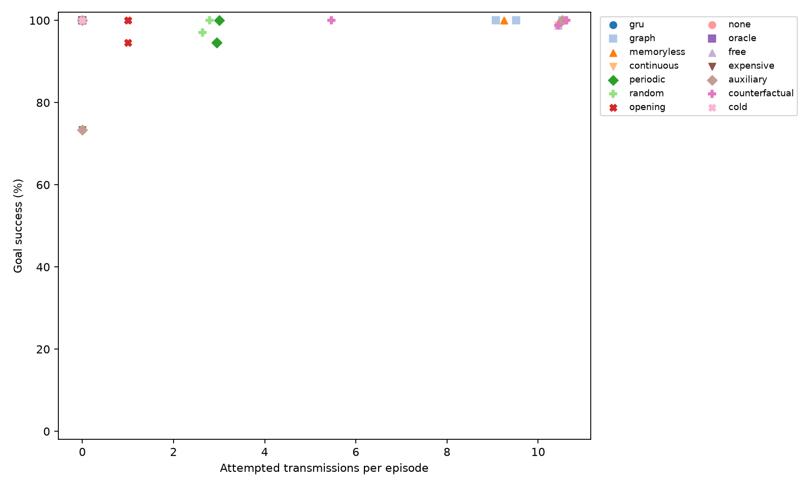
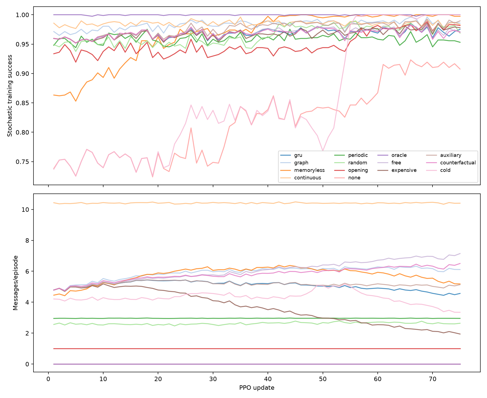

# Optional communication in ALKoG: experimental report

## Executive findings

The main study completed 42 runs (14 methods x 3 seeds), followed by 9 runs covering prescribed sparse timing and two learned counterfactual gates.

- **prescribed_event_control**: success 1.000 +/- 0.000, messages/episode 1.146 +/- 0.000, hazard rate 0.000 +/- 0.000.
- **paired_counterfactual_regression**: success 1.000 +/- 0.000, messages/episode 4.749 +/- 0.167, hazard rate 0.000 +/- 0.000.
- **paired_counterfactual_classification**: success 0.964 +/- 0.012, messages/episode 0.400 +/- 0.172, hazard rate 0.036 +/- 0.012.

The key result is that counterfactual packet value can train selective communication in this limited task, with a measurable success/message tradeoff. Standard PPO and a message penalty did not reliably recover the desired sparse protocol at the tested budget. These are oracle-state findings; visual and private-location experiments remain future work.

**Critical negative result:** the cold communication-start arm learned silent conservative navigation and achieved 100% success across all three seeds, with zero evaluation transmissions. Its common-cost return (4.895) exceeds both learned paired-gate variants. Thus this task does **not** establish an overall communication advantage over the best trained silent policy. The paired interventions establish a benefit of timing for a particular frozen partner, which is a narrower claim.

The next task should strengthen the information asymmetry or route-efficiency tradeoff, and evaluate against the strongest conservative silent policy. Private goal/location information is one option. This does not overturn communication benefits established in a different experimental branch.

## Scope and main result

This is an executed, controlled oracle kinematic-grid study. It tests optional transmission, persistent safety belief, and independent navigation. It does not establish visual grounding, physical safety, language-like semantics, or private-location communication. Read every safety result as a finite held-out measurement.

Completed **42 runs**, 14 methods, seeds [0, 1, 2]. Each run uses 75 updates x 24 steps x 256 lanes = **460,800 allocated lane-steps** across 19,200 generated episodes. Lane-steps include absorbing padding after success/death; they are not a count of active environment interactions. There are 1,024 evaluation episodes per condition.

All aggregate spreads below are sample standard deviations across training seeds. They are descriptive, not significance tests. Scores use final checkpoints; no held-out checkpoint selection was performed.

The original scene seed 900001 overlapped the development checks. Those scores are retained as development evidence only. All primary tables and figures in this report use fresh scene seed 1900001, evaluated on CPU after all model designs and weights were frozen, with 1,024 episodes per condition. No tuning followed this final evaluation.

## Normal dynamic evaluation

| Method | Success | Hazard failures | Timeouts | Messages/episode | Return at common .05 cost |
|---|---:|---:|---:|---:|---:|
| gru | 1.000 +/- 0.000 | 0.000 +/- 0.000 | 0.000 +/- 0.000 | 3.523 +/- 6.103 | 4.735 +/- 0.277 |
| graph | 1.000 +/- 0.000 | 0.000 +/- 0.000 | 0.000 +/- 0.000 | 9.707 +/- 0.748 | 4.459 +/- 0.037 |
| memoryless | 1.000 +/- 0.000 | 0.000 +/- 0.000 | 0.000 +/- 0.000 | 3.083 +/- 5.339 | 4.755 +/- 0.242 |
| continuous | 0.992 +/- 0.007 | 0.008 +/- 0.007 | 0.000 +/- 0.000 | 10.486 +/- 0.073 | 4.313 +/- 0.088 |
| periodic | 0.964 +/- 0.031 | 0.036 +/- 0.031 | 0.000 +/- 0.000 | 2.964 +/- 0.031 | 4.336 +/- 0.388 |
| random | 0.980 +/- 0.017 | 0.020 +/- 0.017 | 0.000 +/- 0.000 | 2.683 +/- 0.090 | 4.536 +/- 0.190 |
| opening | 0.982 +/- 0.031 | 0.018 +/- 0.031 | 0.000 +/- 0.000 | 1.000 +/- 0.000 | 4.628 +/- 0.374 |
| none | 0.911 +/- 0.154 | 0.089 +/- 0.154 | 0.000 +/- 0.000 | 0.000 +/- 0.000 | 3.774 +/- 1.940 |
| oracle | 1.000 +/- 0.000 | 0.000 +/- 0.000 | 0.000 +/- 0.000 | 0.000 +/- 0.000 | 4.947 +/- 0.000 |
| free | 0.992 +/- 0.007 | 0.008 +/- 0.007 | 0.000 +/- 0.000 | 10.486 +/- 0.073 | 4.313 +/- 0.088 |
| expensive | 0.911 +/- 0.154 | 0.089 +/- 0.154 | 0.000 +/- 0.000 | 0.000 +/- 0.000 | 3.774 +/- 1.940 |
| auxiliary | 0.911 +/- 0.154 | 0.089 +/- 0.154 | 0.000 +/- 0.000 | 3.511 +/- 6.081 | 3.616 +/- 1.819 |
| counterfactual | 0.996 +/- 0.007 | 0.004 +/- 0.007 | 0.000 +/- 0.000 | 8.841 +/- 2.929 | 4.430 +/- 0.181 |
| cold | 1.000 +/- 0.000 | 0.000 +/- 0.000 | 0.000 +/- 0.000 | 0.000 +/- 0.000 | 4.895 +/- 0.000 |

## Methods and reproducibility

The complete method specification is reproduced in [methods.md](methods.md). It includes information boundaries, rewards, warm-up supervision, all 14 arms, PPO details, intervention definitions, and limitations.

Runtime: Python 3.11.9; PyTorch 2.14.1+cu130; GPU NVIDIA GeForce RTX 4060 Ti. Base commit `348ef74c9cb2319a8086a74e697c84375dc5d149`; training source SHA-256 `4687e6b22f8fb69c9b5b595edc9cb047496938d30c31f9c3496704baffd75de9`.

Spatial warm-up uses BFS behavior cloning. Communication warm-up maximizes enumerated safety-response reward, including retention over silence. The cold arm removes communication warm-up but retains spatial skill. The safety belief bottleneck is prescribed; public token meanings are learned. This is a modular learning study, not evidence that all semantic structure emerged from navigation reward alone.

Training scenes use matched per-iteration seeds across methods. Each final model has an optimizer/RNG checkpoint, complete learning curve, 30 evaluation cells and 32 paired trajectory examples. Exact source and warm-up weights are saved alongside results. Initial diagnostic scores use separate seed 810001.

## Development attempts

1. Initial 400-update, uniformly sampled spatial warm-up: the oracle receiver collided in roughly 24% of dynamic development episodes. The movement network mostly learned forward travel and ignored rare avoidance situations. This was a navigation failure, so it could not support a communication conclusion.

2. Balanced action classes and emphasized hazard-adjacent cells, with 1,500 warm-up updates: a first oracle check avoided collisions but still timed out in 10.4% of dynamic episodes. Rotation transfer failed. This motivated a larger movement network, not tuning the held-out study outcomes.

3. Final preflight, separate development seed 123: a two-hidden-layer, 128-wide movement network and 25 PPO updates reached 100% oracle and fact-cache success and 98.6% GRU/continuous success on the development dynamic evaluation. The study then fixed architecture and budgets before evaluating seeds 0-2.

These attempts have separate source snapshots and logs in the repository output directory. They are not additional independent replicates of the final study.

## Causal message interventions

The table reports normal success minus intervened success; positive numbers indicate harm from the intervention. Attempts remain charged even if delivery is blocked. Constant payloads preserve timing, so they do not remove all information.

| Method | Delete updates | Constant token | Shuffle | 1-step delay | 25% loss | Delete unchanged updates |
|---|---:|---:|---:|---:|---:|---:|
| gru | 0.018 +/- 0.031 | 0.000 +/- 0.000 | 0.040 +/- 0.070 | 0.004 +/- 0.007 | 0.002 +/- 0.004 | 0.000 +/- 0.000 |
| graph | 0.054 +/- 0.000 | 0.000 +/- 0.000 | 0.133 +/- 0.000 | 0.013 +/- 0.000 | 0.007 +/- 0.000 | 0.000 +/- 0.000 |
| memoryless | 0.000 +/- 0.000 | 0.000 +/- 0.000 | 0.036 +/- 0.063 | 0.004 +/- 0.007 | 0.000 +/- 0.000 | 0.000 +/- 0.000 |
| continuous | 0.045 +/- 0.007 | -0.008 +/- 0.007 | 0.125 +/- 0.003 | 0.021 +/- 0.007 | 0.013 +/- 0.005 | 0.027 +/- 0.024 |
| periodic | 0.018 +/- 0.031 | -0.036 +/- 0.031 | 0.105 +/- 0.006 | 0.018 +/- 0.031 | -0.004 +/- 0.028 | 0.000 +/- 0.000 |
| random | -0.007 +/- 0.006 | -0.020 +/- 0.017 | 0.050 +/- 0.044 | 0.002 +/- 0.002 | -0.001 +/- 0.002 | 0.003 +/- 0.003 |
| opening | 0.000 +/- 0.000 | -0.018 +/- 0.031 | 0.025 +/- 0.043 | 0.000 +/- 0.000 | 0.017 +/- 0.030 | 0.000 +/- 0.000 |
| none | 0.000 +/- 0.000 | 0.000 +/- 0.000 | 0.000 +/- 0.000 | 0.000 +/- 0.000 | 0.000 +/- 0.000 | 0.000 +/- 0.000 |
| oracle | 0.000 +/- 0.000 | 0.000 +/- 0.000 | 0.000 +/- 0.000 | 0.000 +/- 0.000 | 0.000 +/- 0.000 | 0.000 +/- 0.000 |
| free | 0.045 +/- 0.007 | -0.008 +/- 0.007 | 0.125 +/- 0.003 | 0.021 +/- 0.007 | 0.013 +/- 0.005 | 0.027 +/- 0.024 |
| expensive | 0.000 +/- 0.000 | 0.000 +/- 0.000 | 0.000 +/- 0.000 | 0.000 +/- 0.000 | 0.000 +/- 0.000 | 0.000 +/- 0.000 |
| auxiliary | 0.018 +/- 0.031 | 0.000 +/- 0.000 | 0.044 +/- 0.077 | 0.004 +/- 0.007 | 0.002 +/- 0.004 | 0.000 +/- 0.000 |
| counterfactual | 0.032 +/- 0.028 | -0.004 +/- 0.007 | 0.125 +/- 0.016 | 0.012 +/- 0.012 | 0.007 +/- 0.008 | 0.014 +/- 0.024 |
| cold | 0.000 +/- 0.000 | 0.000 +/- 0.000 | 0.000 +/- 0.000 | 0.000 +/- 0.000 | 0.000 +/- 0.000 | 0.000 +/- 0.000 |

## Transmission-rate controls

These interventions replace timing in the same trained pair. They target the normal pair's observed transmission rate per active step. Actual episode message counts can differ because routes, termination times and message histories change. This is an expected-rate control, not exact per-episode budget matching.

| Method | Normal success / messages | Rate-periodic success / messages | Rate-random success / messages |
|---|---:|---:|---:|
| gru | 1.000 +/- 0.000 / 3.523 +/- 6.103 | 1.000 +/- 0.000 / 3.523 +/- 6.103 | 1.000 +/- 0.000 / 3.523 +/- 6.103 |
| graph | 1.000 +/- 0.000 / 9.707 +/- 0.748 | 0.999 +/- 0.001 / 9.685 +/- 0.761 | 0.999 +/- 0.001 / 9.698 +/- 0.745 |
| memoryless | 1.000 +/- 0.000 / 3.083 +/- 5.339 | 1.000 +/- 0.000 / 3.096 +/- 5.363 | 1.000 +/- 0.000 / 3.105 +/- 5.378 |
| continuous | 0.992 +/- 0.007 / 10.486 +/- 0.073 | 0.992 +/- 0.007 / 10.486 +/- 0.073 | 0.992 +/- 0.007 / 10.486 +/- 0.073 |
| periodic | 0.964 +/- 0.031 / 2.964 +/- 0.031 | 0.966 +/- 0.013 / 2.944 +/- 0.006 | 0.960 +/- 0.023 / 3.018 +/- 0.119 |
| random | 0.980 +/- 0.017 / 2.683 +/- 0.090 | 0.977 +/- 0.020 / 2.673 +/- 0.107 | 0.983 +/- 0.015 / 2.702 +/- 0.089 |
| opening | 0.982 +/- 0.031 / 1.000 +/- 0.000 | 0.947 +/- 0.091 / 0.950 +/- 0.061 | 0.945 +/- 0.095 / 0.969 +/- 0.056 |
| none | 0.911 +/- 0.154 / 0.000 +/- 0.000 | 0.911 +/- 0.154 / 0.000 +/- 0.000 | 0.911 +/- 0.154 / 0.000 +/- 0.000 |
| oracle | 1.000 +/- 0.000 / 0.000 +/- 0.000 | 1.000 +/- 0.000 / 0.000 +/- 0.000 | 1.000 +/- 0.000 / 0.000 +/- 0.000 |
| free | 0.992 +/- 0.007 / 10.486 +/- 0.073 | 0.992 +/- 0.007 / 10.486 +/- 0.073 | 0.992 +/- 0.007 / 10.486 +/- 0.073 |
| expensive | 0.911 +/- 0.154 / 0.000 +/- 0.000 | 0.911 +/- 0.154 / 0.000 +/- 0.000 | 0.911 +/- 0.154 / 0.000 +/- 0.000 |
| auxiliary | 0.911 +/- 0.154 / 3.511 +/- 6.081 | 0.911 +/- 0.154 / 3.511 +/- 6.081 | 0.911 +/- 0.154 / 3.511 +/- 6.081 |
| counterfactual | 0.996 +/- 0.007 / 8.841 +/- 2.929 | 0.980 +/- 0.024 / 8.698 +/- 3.177 | 0.985 +/- 0.016 / 8.730 +/- 3.122 |
| cold | 1.000 +/- 0.000 / 0.000 +/- 0.000 | 1.000 +/- 0.000 / 0.000 +/- 0.000 | 1.000 +/- 0.000 / 0.000 +/- 0.000 |

## Memory and event selectivity

Graph denotes a one-fact cache with learned decoding, not a complete knowledge graph. Compare its retention with GRU and memoryless decoding. Event response is measured at the first observation after a flip; relevant/irrelevant geometry is the initial corridor relation, not a counterfactual proof of route relevance.

| Method | Belief accuracy | Send after event | Send without event | Relevant success | Off-corridor success |
|---|---:|---:|---:|---:|---:|
| gru | 0.655 +/- 0.278 | 0.333 +/- 0.577 | 0.333 +/- 0.577 | 1.000 +/- 0.000 | 1.000 +/- 0.000 |
| graph | 0.952 +/- 0.050 | 0.805 +/- 0.188 | 0.925 +/- 0.069 | 1.000 +/- 0.000 | 1.000 +/- 0.000 |
| memoryless | 0.620 +/- 0.218 | 0.333 +/- 0.577 | 0.288 +/- 0.499 | 1.000 +/- 0.000 | 1.000 +/- 0.000 |
| continuous | 0.977 +/- 0.001 | 1.000 +/- 0.000 | 1.000 +/- 0.000 | 0.984 +/- 0.014 | 1.000 +/- 0.000 |
| periodic | 0.843 +/- 0.040 | 0.137 +/- 0.000 | 0.295 +/- 0.006 | 0.932 +/- 0.059 | 1.000 +/- 0.000 |
| random | 0.771 +/- 0.004 | 0.257 +/- 0.000 | 0.251 +/- 0.001 | 0.963 +/- 0.032 | 1.000 +/- 0.000 |
| opening | 0.721 +/- 0.014 | 0.000 +/- 0.000 | 0.097 +/- 0.004 | 0.966 +/- 0.059 | 1.000 +/- 0.000 |
| none | 0.479 +/- 0.026 | 0.000 +/- 0.000 | 0.000 +/- 0.000 | 0.831 +/- 0.292 | 1.000 +/- 0.000 |
| oracle | 1.000 +/- 0.000 | 0.000 +/- 0.000 | 0.000 +/- 0.000 | 1.000 +/- 0.000 | 1.000 +/- 0.000 |
| free | 0.977 +/- 0.001 | 1.000 +/- 0.000 | 1.000 +/- 0.000 | 0.984 +/- 0.014 | 1.000 +/- 0.000 |
| expensive | 0.513 +/- 0.033 | 0.000 +/- 0.000 | 0.000 +/- 0.000 | 0.831 +/- 0.292 | 1.000 +/- 0.000 |
| auxiliary | 0.648 +/- 0.306 | 0.333 +/- 0.577 | 0.333 +/- 0.577 | 0.831 +/- 0.292 | 1.000 +/- 0.000 |
| counterfactual | 0.816 +/- 0.279 | 0.828 +/- 0.298 | 0.831 +/- 0.292 | 0.992 +/- 0.014 | 1.000 +/- 0.000 |
| cold | 0.498 +/- 0.007 | 0.000 +/- 0.000 | 0.000 +/- 0.000 | 1.000 +/- 0.000 | 1.000 +/- 0.000 |

## Transfer and long silence

Static scenes test whether status can persist without updates. Rotated scenes rotate coordinates and movement together, while goal direction is outside the navigation warm-up distribution. Oracle failure on rotation identifies a spatial generalization limitation. Late scenes delay flips by four steps.

| Method | Static success | Static after deleting updates | Rotated success | Late-flip success |
|---|---:|---:|---:|---:|
| gru | 1.000 +/- 0.000 | 1.000 +/- 0.000 | 0.000 +/- 0.000 | 1.000 +/- 0.000 |
| graph | 1.000 +/- 0.000 | 1.000 +/- 0.000 | 0.000 +/- 0.000 | 1.000 +/- 0.000 |
| memoryless | 1.000 +/- 0.000 | 1.000 +/- 0.000 | 0.000 +/- 0.000 | 1.000 +/- 0.000 |
| continuous | 1.000 +/- 0.000 | 1.000 +/- 0.000 | 0.000 +/- 0.000 | 1.000 +/- 0.000 |
| periodic | 1.000 +/- 0.000 | 1.000 +/- 0.000 | 0.000 +/- 0.000 | 1.000 +/- 0.000 |
| random | 1.000 +/- 0.000 | 1.000 +/- 0.000 | 0.000 +/- 0.000 | 1.000 +/- 0.000 |
| opening | 1.000 +/- 0.000 | 1.000 +/- 0.000 | 0.000 +/- 0.000 | 1.000 +/- 0.000 |
| none | 0.907 +/- 0.161 | 0.907 +/- 0.161 | 0.000 +/- 0.000 | 0.907 +/- 0.161 |
| oracle | 1.000 +/- 0.000 | 1.000 +/- 0.000 | 0.000 +/- 0.000 | 1.000 +/- 0.000 |
| free | 1.000 +/- 0.000 | 1.000 +/- 0.000 | 0.000 +/- 0.000 | 1.000 +/- 0.000 |
| expensive | 0.907 +/- 0.161 | 0.907 +/- 0.161 | 0.000 +/- 0.000 | 0.907 +/- 0.161 |
| auxiliary | 0.907 +/- 0.161 | 0.907 +/- 0.161 | 0.000 +/- 0.000 | 0.907 +/- 0.161 |
| counterfactual | 1.000 +/- 0.000 | 1.000 +/- 0.000 | 0.000 +/- 0.000 | 1.000 +/- 0.000 |
| cold | 1.000 +/- 0.000 | 1.000 +/- 0.000 | 0.000 +/- 0.000 | 1.000 +/- 0.000 |

## Per-seed normal results

| Method | Seed | Success | Hazard | Messages | Net return | Training + evaluation seconds |
|---|---:|---:|---:|---:|---:|---:|
| gru | 0 | 1.0000 | 0.0000 | 10.570 | 4.414 | 30.4 |
| graph | 0 | 1.0000 | 0.0000 | 10.533 | 4.420 | 29.4 |
| memoryless | 0 | 1.0000 | 0.0000 | 0.000 | 4.895 | 28.8 |
| continuous | 0 | 1.0000 | 0.0000 | 10.570 | 4.414 | 24.9 |
| periodic | 0 | 1.0000 | 0.0000 | 3.000 | 4.784 | 24.9 |
| random | 0 | 1.0000 | 0.0000 | 2.787 | 4.755 | 25.1 |
| opening | 0 | 0.9463 | 0.0537 | 1.000 | 4.196 | 25.3 |
| none | 0 | 1.0000 | 0.0000 | 0.000 | 4.895 | 17.7 |
| oracle | 0 | 1.0000 | 0.0000 | 0.000 | 4.947 | 17.4 |
| free | 0 | 1.0000 | 0.0000 | 10.570 | 4.943 | 29.2 |
| expensive | 0 | 0.7334 | 0.2666 | 0.000 | 1.534 | 29.6 |
| auxiliary | 0 | 1.0000 | 0.0000 | 10.533 | 4.420 | 30.9 |
| counterfactual | 0 | 1.0000 | 0.0000 | 10.619 | 4.407 | 34.4 |
| cold | 0 | 1.0000 | 0.0000 | 0.000 | 4.895 | 30.9 |
| gru | 1 | 1.0000 | 0.0000 | 0.000 | 4.895 | 30.6 |
| graph | 1 | 1.0000 | 0.0000 | 9.513 | 4.465 | 30.8 |
| memoryless | 1 | 1.0000 | 0.0000 | 0.000 | 4.895 | 30.0 |
| continuous | 1 | 0.9873 | 0.0127 | 10.444 | 4.262 | 27.8 |
| periodic | 1 | 0.9463 | 0.0537 | 2.946 | 4.112 | 30.0 |
| random | 1 | 0.9707 | 0.0293 | 2.631 | 4.426 | 27.9 |
| opening | 1 | 1.0000 | 0.0000 | 1.000 | 4.845 | 27.3 |
| none | 1 | 1.0000 | 0.0000 | 0.000 | 4.895 | 17.9 |
| oracle | 1 | 1.0000 | 0.0000 | 0.000 | 4.947 | 20.0 |
| free | 1 | 0.9873 | 0.0127 | 10.444 | 4.784 | 33.2 |
| expensive | 1 | 1.0000 | 0.0000 | 0.000 | 4.895 | 29.2 |
| auxiliary | 1 | 1.0000 | 0.0000 | 0.000 | 4.895 | 30.1 |
| counterfactual | 1 | 0.9873 | 0.0127 | 10.444 | 4.262 | 31.3 |
| cold | 1 | 1.0000 | 0.0000 | 0.000 | 4.895 | 31.5 |
| gru | 2 | 1.0000 | 0.0000 | 0.000 | 4.895 | 31.3 |
| graph | 2 | 1.0000 | 0.0000 | 9.075 | 4.493 | 34.7 |
| memoryless | 2 | 1.0000 | 0.0000 | 9.248 | 4.476 | 29.8 |
| continuous | 2 | 0.9873 | 0.0127 | 10.444 | 4.262 | 25.8 |
| periodic | 2 | 0.9463 | 0.0537 | 2.946 | 4.112 | 26.1 |
| random | 2 | 0.9707 | 0.0293 | 2.631 | 4.426 | 25.9 |
| opening | 2 | 1.0000 | 0.0000 | 1.000 | 4.845 | 25.9 |
| none | 2 | 0.7334 | 0.2666 | 0.000 | 1.534 | 17.8 |
| oracle | 2 | 1.0000 | 0.0000 | 0.000 | 4.947 | 17.7 |
| free | 2 | 0.9873 | 0.0127 | 10.444 | 4.784 | 30.0 |
| expensive | 2 | 1.0000 | 0.0000 | 0.000 | 4.895 | 31.3 |
| auxiliary | 2 | 0.7334 | 0.2666 | 0.000 | 1.534 | 30.2 |
| counterfactual | 2 | 1.0000 | 0.0000 | 5.460 | 4.622 | 31.4 |
| cold | 2 | 1.0000 | 0.0000 | 0.000 | 4.895 | 30.1 |

## Interpretation limits

- Deterministic evaluation can differ from stochastic training; a gate whose probability barely exceeds .5 may transmit at every evaluation step.
- Reward permits safe conservative detours without communication. Silence can be rational; communication usefulness depends on efficiency as well as success.
- The sender sees its own true observations and transmission history; the receiver never sees true private status except in the explicit oracle condition.
- One binary safety fact and four possible tokens do not test compositionality, reference, private locations, multiple relations, or general graph learning.
- The counterfactual gate uses fitted unchosen Q estimates, not experimentally observed alternative rewards. Its success would not validate exact causal value estimation.
- All grid motion is kinematic. This study does not train in MuJoCo, transfer visual perception, or establish physical safety. Existing MuJoCo baselines were regression-tested.
- Three seeds and a single training budget characterize this implementation; they do not establish asymptotic superiority or a general impossibility result.

Raw data: [all evaluation cells](all-evaluations.csv), [manifest](manifest.json), [environment lock](requirements-lock.txt).

## Follow-up: sparse achievability and learned counterfactual timing

These follow-ups respond to the initial study's frequent-transmission/silence outcomes. They are separate experiments, not extra equal-budget arms. There are three seeds for each method. The event control is prescribed; the other two gates are learned.

| Follow-up | Success | Hazard | Messages/episode | Net return |
|---|---:|---:|---:|---:|
| prescribed_event_control | 1.000 +/- 0.000 | 0.000 +/- 0.000 | 1.146 +/- 0.000 | 4.889 +/- 0.000 |
| paired_counterfactual_regression | 1.000 +/- 0.000 | 0.000 +/- 0.000 | 4.749 +/- 0.167 | 4.696 +/- 0.008 |
| paired_counterfactual_classification | 0.964 +/- 0.012 | 0.036 +/- 0.012 | 0.400 +/- 0.172 | 4.451 +/- 0.151 |

**Prescribed event control.** Start from the same fact-cache warm-up, then train the learned message code and navigator for the same 75 PPO updates. The gate sends at reset and when changed status threatens the initial route before passing the lion. This timing rule uses task knowledge and is an achievability control, not evidence of emergent timing. Its learned code/controller warm-start the next two methods.

**Paired return regression.** Freeze that partner and code. Generate 80 batches of 256 initial scenes. At decision times cycling from 0 through 9, random sparse prefix communication creates a range of memory states. Fork each active state into SEND and SILENT, then allow no further transmissions in either continuation until the original 24-step deadline. Deterministic navigation and identical starting states isolate the one-packet return difference, including the .05 cost. Fit a local sender-only 64-wide gate to these differences with 2,000 Adam updates, batch size 512, learning rate .001. Rare positive states are oversampled. Send when predicted difference exceeds zero. This assumes silent continuation during training, so it is not an optimal multi-packet communication value.

**Paired usefulness classification.** Use the same fork data and frozen partner, but predict whether the packet has positive return difference using unweighted binary cross entropy and uniform state sampling. Same architecture, batch size and 2,000-update budget. A .5 threshold selects sends. Unlike regression, it discards the magnitude of benefit and cost. This can favor very sparse transmission while missing valuable packets.

Both learned gates use only sender observations and its own transmission history at deployment. Ground-truth alternative outcomes are available during training through simulation forks. This is extra supervision and computation; it is not a sample-efficiency victory over the initial PPO methods. CPU execution was used for these small follow-ups; the main 42-run study used CUDA.

| Method | Seed | Labeled active states | Positive states | Extra active fork transitions |
|---|---:|---:|---:|---:|
| paired_counterfactual_regression | 0 | 19423 | 1641 | 221252 |
| paired_counterfactual_classification | 0 | 19423 | 1641 | 221252 |
| paired_counterfactual_regression | 1 | 19501 | 1571 | 221664 |
| paired_counterfactual_classification | 1 | 19501 | 1571 | 221664 |
| paired_counterfactual_regression | 2 | 19440 | 3261 | 227766 |
| paired_counterfactual_classification | 2 | 19440 | 3261 | 227766 |

Regression and classification reuse identical generated-state/fork data per seed, but the scripts execute the fork computation separately. The transition counts above count active simulator steps before termination, including the terminal transition; absorbing padding is excluded.

| Method | Delete updates: success | Constant payload: success | Matched periodic: success / messages | Matched random: success / messages |
|---|---:|---:|---:|---:|
| prescribed_event_control | 0.946 +/- 0.000 | 1.000 +/- 0.000 | 0.850 +/- 0.000 / 0.998 +/- 0.000 | 0.843 +/- 0.000 / 1.024 +/- 0.020 |
| paired_counterfactual_regression | 0.946 +/- 0.000 | 1.000 +/- 0.000 | 0.991 +/- 0.001 / 4.665 +/- 0.154 | 0.973 +/- 0.003 / 4.646 +/- 0.172 |
| paired_counterfactual_classification | 0.946 +/- 0.000 | 0.979 +/- 0.019 | 0.772 +/- 0.017 / 0.343 +/- 0.161 | 0.773 +/- 0.018 / 0.348 +/- 0.181 |

Constant-payload robustness can mean that timing conveys the warning. It does not establish that no communication is occurring. Expected-rate replacement schedules have different realized message counts and histories; these interventions isolate a timing effect under the frozen pair, not an optimal independently retrained alternative.

## Findings and recommendation

The experiments support a distinction between learning a useful communication channel and learning its opportunity cost. Standard joint PPO can obtain high task success while transmitting almost continuously, and a higher message cost can instead favor silence. Memory alone does not guarantee selective communication.

The prescribed sparse control establishes that occasional updates are sufficient for this restricted task. The paired experiments provide a direct learning mechanism: estimate how much a packet changes the partner's resulting return, then learn a sender-only approximation to that value. Read their success, hazard and message counts together: minimizing messages and preserving success are different objectives, and usefulness classification throws away the magnitude of a missed warning.

For the next ALKoG iteration, use recurrent or persistent belief memory, independent navigation, and a gate trained from packet-value comparisons. Prefer return magnitude over a bare useful/not-useful label when missed updates have unequal consequences. Periodically refresh comparisons as the partner changes. A learned critic can amortize the expensive forks, but its unchosen-action estimates need validation against actual paired outcomes.

The present data do not justify claims about the full knowledge graph, visual perception, private location descriptions or physical navigation. Those remain explicitly unexecuted extensions. This report completes the described oracle mechanism study and its follow-ups; it is not a claim that every broader research direction in the preceding theoretical discussion has been implemented.

## Validation and artifacts

The existing standalone Gumbel pipeline suite plus the new mechanism tests passed: 133 tests. Tests cover observation isolation, private status flips, absorbing terminals, exact recurrent PPO replay, sender gradients, retention during silence, contextual action selection, and terminal advantage masking. The test suite uses controlled perception inputs; it does not download or validate SAM/ResNet visual checkpoints. Additional fork tests check identical branches under a partner that ignores communication and isolate transmission cost.

The artifact bundle contains new source, dependency lock, all final checkpoints, warm-up states, curves, evaluation cells, selected paired trajectories, fork datasets, development logs and source snapshots. Run configuration and source hashes accompany the main study. No remote branches were pushed.

## Relation to prior work

- [IC3Net](https://arxiv.org/abs/1812.09755) provides a precedent for learned communication gates.
- [ETCNet](https://arxiv.org/abs/2010.04978) studies event-triggered communication under bandwidth constraints.
- [MACC](https://arxiv.org/abs/2006.07200) addresses communication credit assignment with counterfactual reasoning. The fitted-Q and explicit fork methods in this report are simplified experimental designs, not reproductions of MACC.
